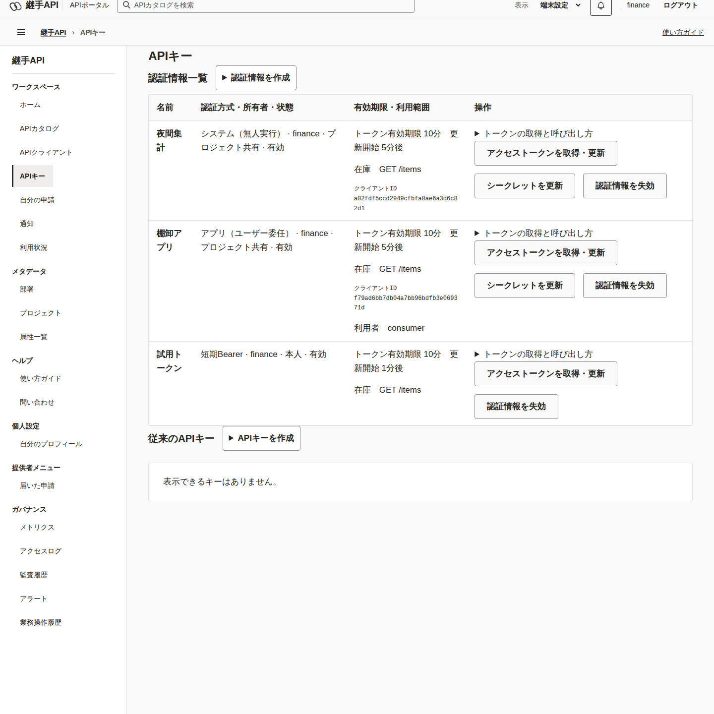

# リーダーは、プロジェクトで無人実行するとき、システム認証を発行できる

判定　合格

対象コミット　`413280ee0b9fbeb2f02c47a6a1a2080583707787`

[検証した要件と変更履歴](https://github.com/tsuji-tomonori/tsugite-api/blob/413280ee0b9fbeb2f02c47a6a1a2080583707787/docs/requirements/items/%E3%83%AA%E3%83%BC%E3%83%80%E3%83%BC%E3%81%AF%E3%80%81%E3%83%97%E3%83%AD%E3%82%B8%E3%82%A7%E3%82%AF%E3%83%88%E3%81%A7%E7%84%A1%E4%BA%BA%E5%AE%9F%E8%A1%8C%E3%81%99%E3%82%8B%E3%81%A8%E3%81%8D%E3%80%81%E3%82%B7%E3%82%B9%E3%83%86%E3%83%A0%E8%AA%8D%E8%A8%BC%E3%82%92%E7%99%BA%E8%A1%8C%E3%81%A7%E3%81%8D%E3%82%8B.md)

## 実行したテストと証跡

- 成功　ブラウザーで3方式を発行し、実時計で1分後に更新、シークレット変更・失効まで確認する（66.658 秒）　`tests/e2e/browser/test_credentials_console.py::test_credentials_console`
  - 
- 成功　AWS EmulatorのCognito利用者とシステムのトークンを発行し、HTTPS到達・拒否・秘密更新を確認する（7.536 秒）　`tests/e2e/aws/test_credential_tokens.py::test_client_tokens_reach_https`

[テスト実行記録（JUnit XML）](%E3%83%AA%E3%83%BC%E3%83%80%E3%83%BC%E3%81%AF%E3%80%81%E3%83%97%E3%83%AD%E3%82%B8%E3%82%A7%E3%82%AF%E3%83%88%E3%81%A7%E7%84%A1%E4%BA%BA%E5%AE%9F%E8%A1%8C%E3%81%99%E3%82%8B%E3%81%A8%E3%81%8D%E3%80%81%E3%82%B7%E3%82%B9%E3%83%86%E3%83%A0%E8%AA%8D%E8%A8%BC%E3%82%92%E7%99%BA%E8%A1%8C%E3%81%A7%E3%81%8D%E3%82%8B.xml)
