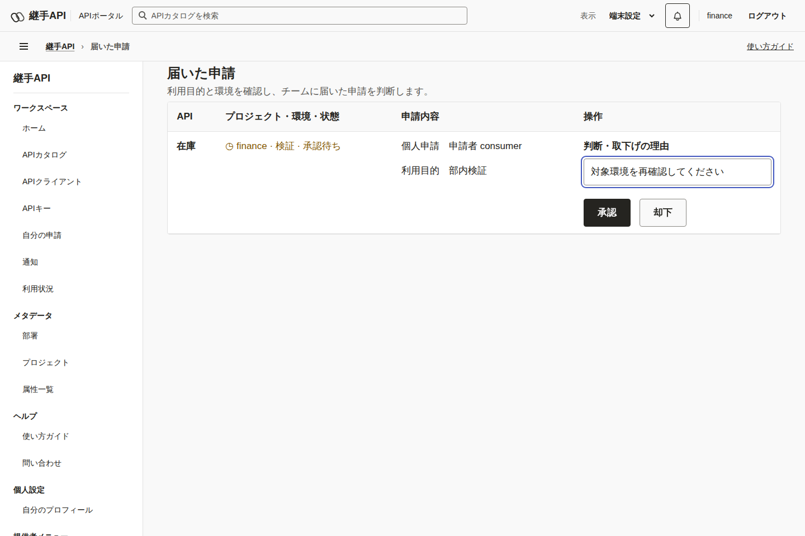

# リーダーは、利用申請の判断を委任されたとき、承認または却下を決定できる

判定　合格

対象コミット　`3f236ef119c9f98eded43090ae3f5e98464527df`

[検証した要件と変更履歴](https://github.com/tsuji-tomonori/tsugite-api/blob/3f236ef119c9f98eded43090ae3f5e98464527df/docs/requirements/items/%E3%83%AA%E3%83%BC%E3%83%80%E3%83%BC%E3%81%AF%E3%80%81%E5%88%A9%E7%94%A8%E7%94%B3%E8%AB%8B%E3%81%AE%E5%88%A4%E6%96%AD%E3%82%92%E5%A7%94%E4%BB%BB%E3%81%95%E3%82%8C%E3%81%9F%E3%81%A8%E3%81%8D%E3%80%81%E6%89%BF%E8%AA%8D%E3%81%BE%E3%81%9F%E3%81%AF%E5%8D%B4%E4%B8%8B%E3%82%92%E6%B1%BA%E5%AE%9A%E3%81%A7%E3%81%8D%E3%82%8B.md)

## 実行したテストと証跡

- 成功　提供者が公開・自動承認・委任の条件を保存し、部署リーダーが個人申請を画面から却下する（13.823 秒）　`tests/e2e/browser/test_delegation_console.py::test_provider_policy_console`
  - 
- 成功　公開範囲、委任判断、個人・プロジェクト別申請、部署・役職の自動承認を確認する（0.777 秒）　`packages/backend/tests/test_org_access.py::test_delegation_search_and_personal_isolation`
- 成功　利用条件と部署・提供者の承認順を再生し、最終判断まで呼び出しを拒否する。（形式仕様の操作と期待状態を照合する。）（0.516 秒）　`packages/backend/tests/test_quint_grants.py::test_ordered_history[review.orderedTest]`
- 成功　利用条件と部署・提供者の承認順を再生し、最終判断まで呼び出しを拒否する。（形式仕様の操作と期待状態を照合する。）（0.433 秒）　`packages/backend/tests/test_quint_grants.py::test_ordered_history[review.termsTest]`

[テスト実行記録（JUnit XML）](%E3%83%AA%E3%83%BC%E3%83%80%E3%83%BC%E3%81%AF%E3%80%81%E5%88%A9%E7%94%A8%E7%94%B3%E8%AB%8B%E3%81%AE%E5%88%A4%E6%96%AD%E3%82%92%E5%A7%94%E4%BB%BB%E3%81%95%E3%82%8C%E3%81%9F%E3%81%A8%E3%81%8D%E3%80%81%E6%89%BF%E8%AA%8D%E3%81%BE%E3%81%9F%E3%81%AF%E5%8D%B4%E4%B8%8B%E3%82%92%E6%B1%BA%E5%AE%9A%E3%81%A7%E3%81%8D%E3%82%8B.xml)
