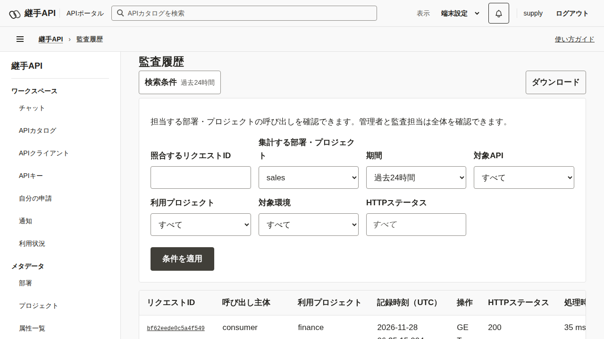

# リーダーは、担当するプロジェクトの呼び出しを調べるとき、配下のアクセスログを監査できる

判定　合格

対象コミット　`01130309252051badc6cb01f91b2a33a407ed01c`

## 実行したテストと証跡

- 成功　部署リーダーが配下の別人の呼び出しを監査し、リーダー解除後は詳細を再表示できない。（9.385 秒）　`tests/e2e/browser/test_requirement_flows.py::test_lead_access_audit`
  - 
- 成功　同じ所属でも本人の履歴を分離し、配下の監査・絞り込み・出力と権限解除を検証する。（0.448 秒）　`packages/backend/tests/test_org_access.py::test_access_log_scopes`

[テスト実行記録（JUnit XML）](%E3%83%AA%E3%83%BC%E3%83%80%E3%83%BC%E3%81%AF%E3%80%81%E6%8B%85%E5%BD%93%E3%81%99%E3%82%8B%E3%83%97%E3%83%AD%E3%82%B8%E3%82%A7%E3%82%AF%E3%83%88%E3%81%AE%E5%91%BC%E3%81%B3%E5%87%BA%E3%81%97%E3%82%92%E8%AA%BF%E3%81%B9%E3%82%8B%E3%81%A8%E3%81%8D%E3%80%81%E9%85%8D%E4%B8%8B%E3%81%AE%E3%82%A2%E3%82%AF%E3%82%BB%E3%82%B9%E3%83%AD%E3%82%B0%E3%82%92%E7%9B%A3%E6%9F%BB%E3%81%A7%E3%81%8D%E3%82%8B.xml)
