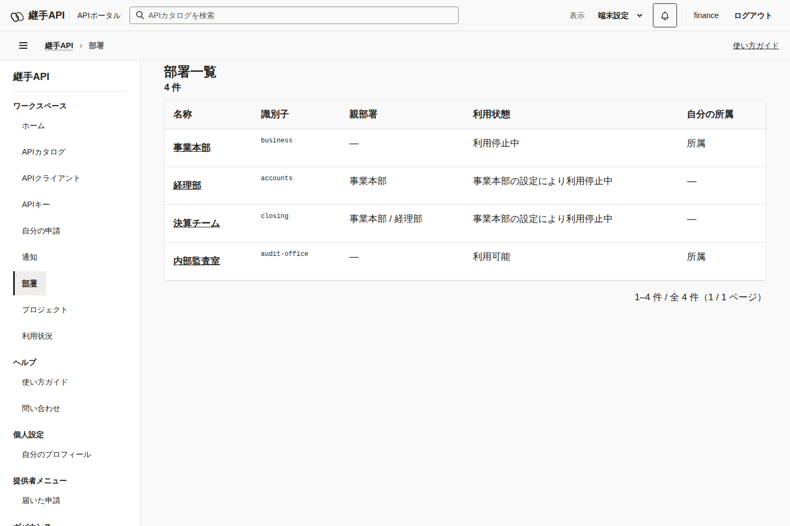

# リーダーは、担当する部署やプロジェクトの利用を制御するとき、APIの利用を停止または再開できる

判定　合格

対象コミット　`9a2088d8c854dae9b01bb1e76dc4a8081b914924`

## 実行したテストと証跡

- 成功　管理者が組織階層と兼務を設定し、リーダーがキー・利用状況・停止と再開を操作する（15.377 秒）　`tests/e2e/browser/test_workspace_console.py::test_workspace_key_console`
  - 

[テスト実行記録（JUnit XML）](%E3%83%AA%E3%83%BC%E3%83%80%E3%83%BC%E3%81%AF%E3%80%81%E6%8B%85%E5%BD%93%E3%81%99%E3%82%8B%E9%83%A8%E7%BD%B2%E3%82%84%E3%83%97%E3%83%AD%E3%82%B8%E3%82%A7%E3%82%AF%E3%83%88%E3%81%AE%E5%88%A9%E7%94%A8%E3%82%92%E5%88%B6%E5%BE%A1%E3%81%99%E3%82%8B%E3%81%A8%E3%81%8D%E3%80%81API%E3%81%AE%E5%88%A9%E7%94%A8%E3%82%92%E5%81%9C%E6%AD%A2%E3%81%BE%E3%81%9F%E3%81%AF%E5%86%8D%E9%96%8B%E3%81%A7%E3%81%8D%E3%82%8B.xml)
