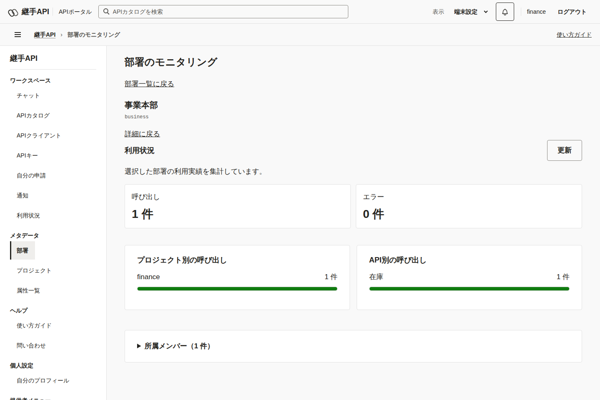

# リーダーは、担当する部署を管理するとき、所属と利用状況を確認できる

判定　合格

対象コミット　`6f47997508f5b067db9632c3a425ced87ee8955a`

## 実行したテストと証跡

- 成功　管理者が組織階層と兼務を設定し、リーダーがキー・利用状況・停止と再開を操作する（11.763 秒）　`tests/e2e/browser/test_workspace_console.py::test_workspace_key_console`
  - 

[テスト実行記録（JUnit XML）](%E3%83%AA%E3%83%BC%E3%83%80%E3%83%BC%E3%81%AF%E3%80%81%E6%8B%85%E5%BD%93%E3%81%99%E3%82%8B%E9%83%A8%E7%BD%B2%E3%82%92%E7%AE%A1%E7%90%86%E3%81%99%E3%82%8B%E3%81%A8%E3%81%8D%E3%80%81%E6%89%80%E5%B1%9E%E3%81%A8%E5%88%A9%E7%94%A8%E7%8A%B6%E6%B3%81%E3%82%92%E7%A2%BA%E8%AA%8D%E3%81%A7%E3%81%8D%E3%82%8B.xml)
