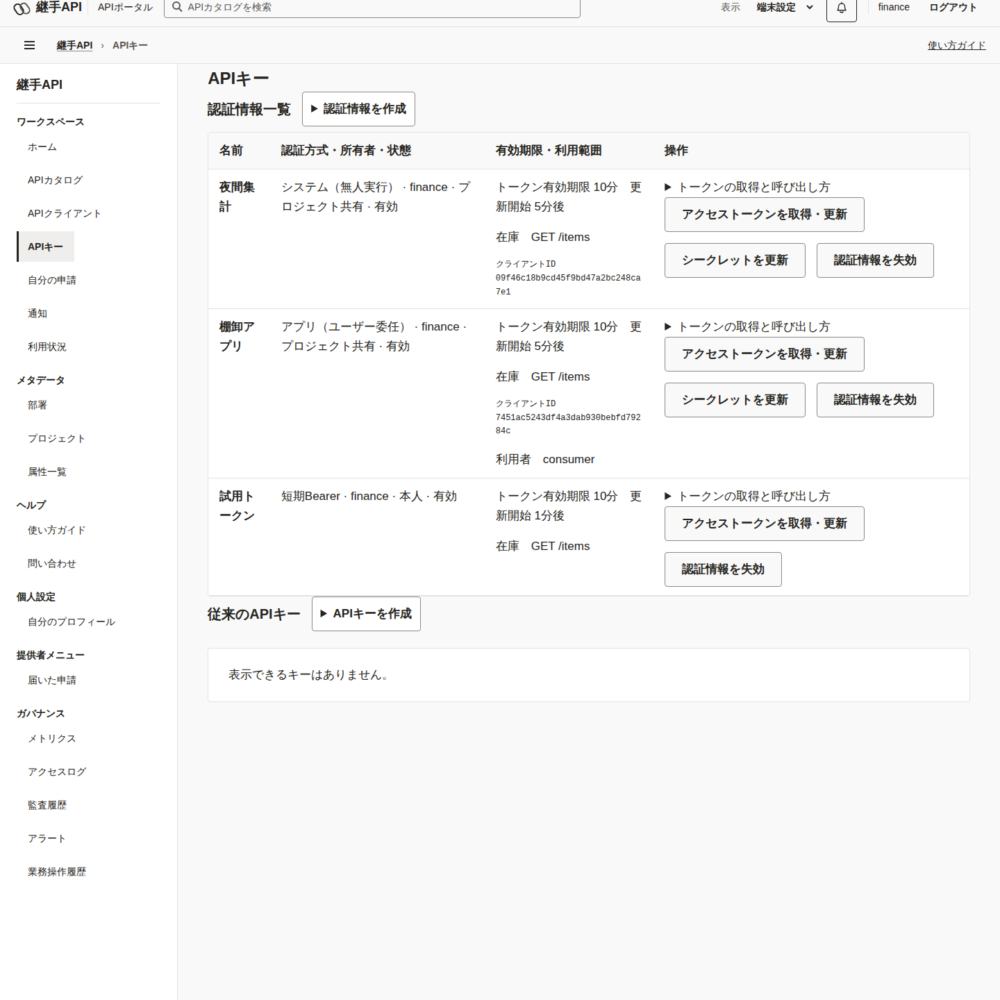

# 利用者は、APIを一時的に呼び出すとき、短期Bearerを発行できる

判定　合格

対象コミット　`0d81e69c4ba4290f5d99ca15e8d1abe968d87a3b`

[検証した要件と変更履歴](https://github.com/tsuji-tomonori/tsugite-api/blob/0d81e69c4ba4290f5d99ca15e8d1abe968d87a3b/docs/requirements/items/%E5%88%A9%E7%94%A8%E8%80%85%E3%81%AF%E3%80%81API%E3%82%92%E4%B8%80%E6%99%82%E7%9A%84%E3%81%AB%E5%91%BC%E3%81%B3%E5%87%BA%E3%81%99%E3%81%A8%E3%81%8D%E3%80%81%E7%9F%AD%E6%9C%9FBearer%E3%82%92%E7%99%BA%E8%A1%8C%E3%81%A7%E3%81%8D%E3%82%8B.md)

## 実行したテストと証跡

- 成功　ブラウザーで3方式を発行し、実時計で1分後に更新、シークレット変更・失効まで確認する（65.636 秒）　`tests/e2e/browser/test_credentials_console.py::test_credentials_console`
  - 

[テスト実行記録（JUnit XML）](%E5%88%A9%E7%94%A8%E8%80%85%E3%81%AF%E3%80%81API%E3%82%92%E4%B8%80%E6%99%82%E7%9A%84%E3%81%AB%E5%91%BC%E3%81%B3%E5%87%BA%E3%81%99%E3%81%A8%E3%81%8D%E3%80%81%E7%9F%AD%E6%9C%9FBearer%E3%82%92%E7%99%BA%E8%A1%8C%E3%81%A7%E3%81%8D%E3%82%8B.xml)
