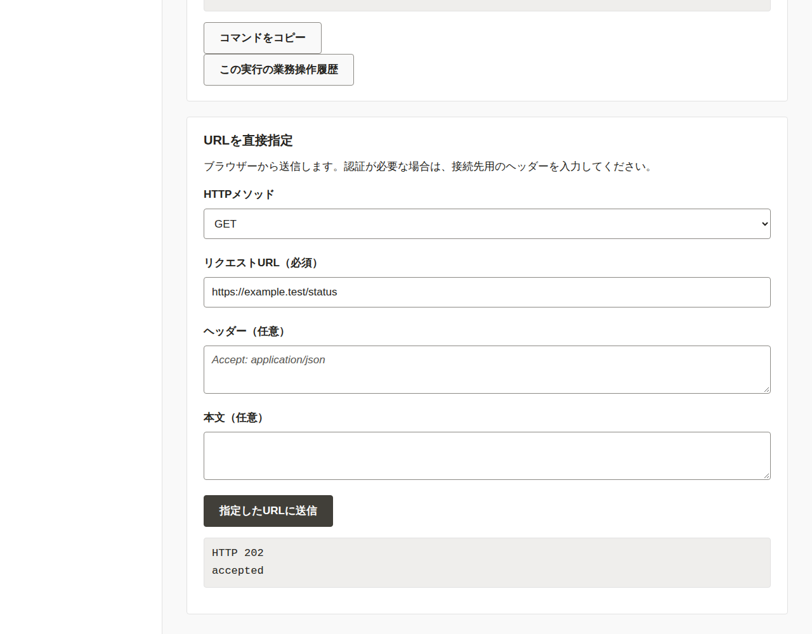

# 利用者は、APIを呼び出すとき、承認済みの操作またはURLを指定して実行できる

判定　合格

対象コミット　`6f47997508f5b067db9632c3a425ced87ee8955a`

## 実行したテストと証跡

- 成功　OpenAPIの型からパス・クエリ・JSONを入力し、選択したキーでHTTPSの送料計算を実行する（6.949 秒）　`tests/e2e/browser/test_api_docs.py::test_openapi_key_console`
  - 
- 成功　OpenAPIの型からパス・クエリ・JSONを入力し、選択したキーでHTTPSの送料計算を実行する（6.949 秒）　`tests/e2e/browser/test_api_docs.py::test_openapi_key_console`
  - 

[テスト実行記録（JUnit XML）](%E5%88%A9%E7%94%A8%E8%80%85%E3%81%AF%E3%80%81API%E3%82%92%E5%91%BC%E3%81%B3%E5%87%BA%E3%81%99%E3%81%A8%E3%81%8D%E3%80%81%E6%89%BF%E8%AA%8D%E6%B8%88%E3%81%BF%E3%81%AE%E6%93%8D%E4%BD%9C%E3%81%BE%E3%81%9F%E3%81%AFURL%E3%82%92%E6%8C%87%E5%AE%9A%E3%81%97%E3%81%A6%E5%AE%9F%E8%A1%8C%E3%81%A7%E3%81%8D%E3%82%8B.xml)
