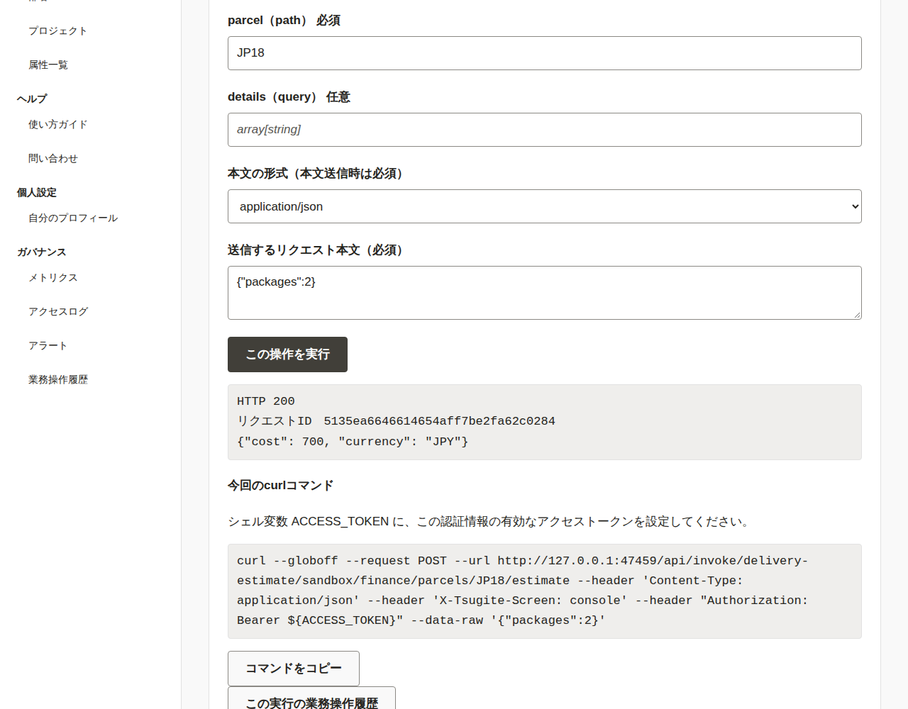

# 利用者は、APIを呼び出すとき、承認済みの操作またはURLを指定して実行できる

判定　合格

対象コミット　`e7d27c12156a070acf58bd298f088bc776c372dc`

[検証した要件と変更履歴](https://github.com/tsuji-tomonori/tsugite-api/blob/e7d27c12156a070acf58bd298f088bc776c372dc/docs/requirements/items/%E5%88%A9%E7%94%A8%E8%80%85%E3%81%AF%E3%80%81API%E3%82%92%E5%91%BC%E3%81%B3%E5%87%BA%E3%81%99%E3%81%A8%E3%81%8D%E3%80%81%E6%89%BF%E8%AA%8D%E6%B8%88%E3%81%BF%E3%81%AE%E6%93%8D%E4%BD%9C%E3%81%BE%E3%81%9F%E3%81%AFURL%E3%82%92%E6%8C%87%E5%AE%9A%E3%81%97%E3%81%A6%E5%AE%9F%E8%A1%8C%E3%81%A7%E3%81%8D%E3%82%8B.md)

## 実行したテストと証跡

- 成功　OpenAPIの型からパス・クエリ・JSONを入力し、選択したキーでHTTPSの送料計算を実行する（8.011 秒）　`tests/e2e/browser/test_api_docs.py::test_openapi_key_console`
  - 
- 成功　OpenAPIの型からパス・クエリ・JSONを入力し、選択したキーでHTTPSの送料計算を実行する（8.011 秒）　`tests/e2e/browser/test_api_docs.py::test_openapi_key_console`
  - 
- 成功　URL直接指定では入力したヘッダーと本文だけを使い、Cookieとリダイレクトを無効にする。（0.003 秒）　`packages/frontend/tests/test_api_client.py::test_manual_request_uses_only_entered_headers`
- 成功　利用権の操作列を再生し、取消や別環境では接続先への転送が起きない。（形式仕様の操作と期待状態を照合する。）（0.247 秒）　`packages/backend/tests/test_quint_grants.py::test_grant_history[grants.closedTest]`
- 成功　利用権の操作列を再生し、取消や別環境では接続先への転送が起きない。（形式仕様の操作と期待状態を照合する。）（0.321 秒）　`packages/backend/tests/test_quint_grants.py::test_grant_history[grants.lifecycleTest]`
- 成功　利用権の操作列を再生し、取消や別環境では接続先への転送が起きない。（形式仕様の操作と期待状態を照合する。）（0.338 秒）　`packages/backend/tests/test_quint_grants.py::test_grant_history[grants.reapplyTest]`
- 成功　利用権の操作列を再生し、取消や別環境では接続先への転送が起きない。（形式仕様の操作と期待状態を照合する。）（0.295 秒）　`packages/backend/tests/test_quint_grants.py::test_grant_history[grants.scopeTest]`
- 成功　認証情報と利用者の操作制限、世代、発行後の秒境界を照合する。（形式仕様の操作と期待状態を照合する。）（0.001 秒）　`packages/backend/tests/test_quint_policy.py::test_operation_policy[credentials.lifetimeTest]`
- 成功　認証情報と利用者の操作制限、世代、発行後の秒境界を照合する。（形式仕様の操作と期待状態を照合する。）（0.000 秒）　`packages/backend/tests/test_quint_policy.py::test_operation_policy[credentials.operationsTest]`
- 成功　認証情報と利用者の操作制限、世代、発行後の秒境界を照合する。（形式仕様の操作と期待状態を照合する。）（0.000 秒）　`packages/backend/tests/test_quint_policy.py::test_operation_policy[credentials.rotatedTest]`
- 成功　クライアントには承認商品と操作の選択肢があり、手動URL送信用の独立した入力欄もある。（0.013 秒）　`packages/frontend/tests/test_required_product_views.py::test_console_shows_approved_operations_and_manual_url`

[テスト実行記録（JUnit XML）](%E5%88%A9%E7%94%A8%E8%80%85%E3%81%AF%E3%80%81API%E3%82%92%E5%91%BC%E3%81%B3%E5%87%BA%E3%81%99%E3%81%A8%E3%81%8D%E3%80%81%E6%89%BF%E8%AA%8D%E6%B8%88%E3%81%BF%E3%81%AE%E6%93%8D%E4%BD%9C%E3%81%BE%E3%81%9F%E3%81%AFURL%E3%82%92%E6%8C%87%E5%AE%9A%E3%81%97%E3%81%A6%E5%AE%9F%E8%A1%8C%E3%81%A7%E3%81%8D%E3%82%8B.xml)
