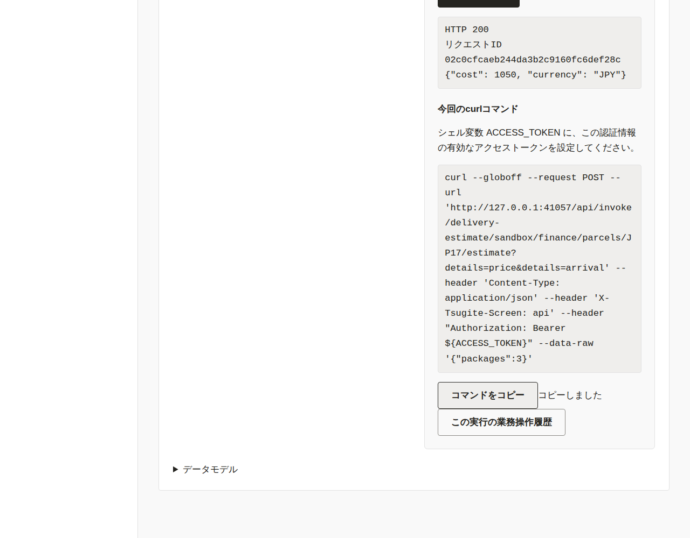

# 利用者は、API操作を試すとき、API Docsから呼び出しできる

判定　合格

対象コミット　`9a2088d8c854dae9b01bb1e76dc4a8081b914924`

## 実行したテストと証跡

- 成功　OpenAPIの型からパス・クエリ・JSONを入力し、選択したキーでHTTPSの送料計算を実行する（10.794 秒）　`tests/e2e/browser/test_api_docs.py::test_openapi_key_console`
  - 

[テスト実行記録（JUnit XML）](%E5%88%A9%E7%94%A8%E8%80%85%E3%81%AF%E3%80%81API%E6%93%8D%E4%BD%9C%E3%82%92%E8%A9%A6%E3%81%99%E3%81%A8%E3%81%8D%E3%80%81API%20Docs%E3%81%8B%E3%82%89%E5%91%BC%E3%81%B3%E5%87%BA%E3%81%97%E3%81%A7%E3%81%8D%E3%82%8B.xml)
