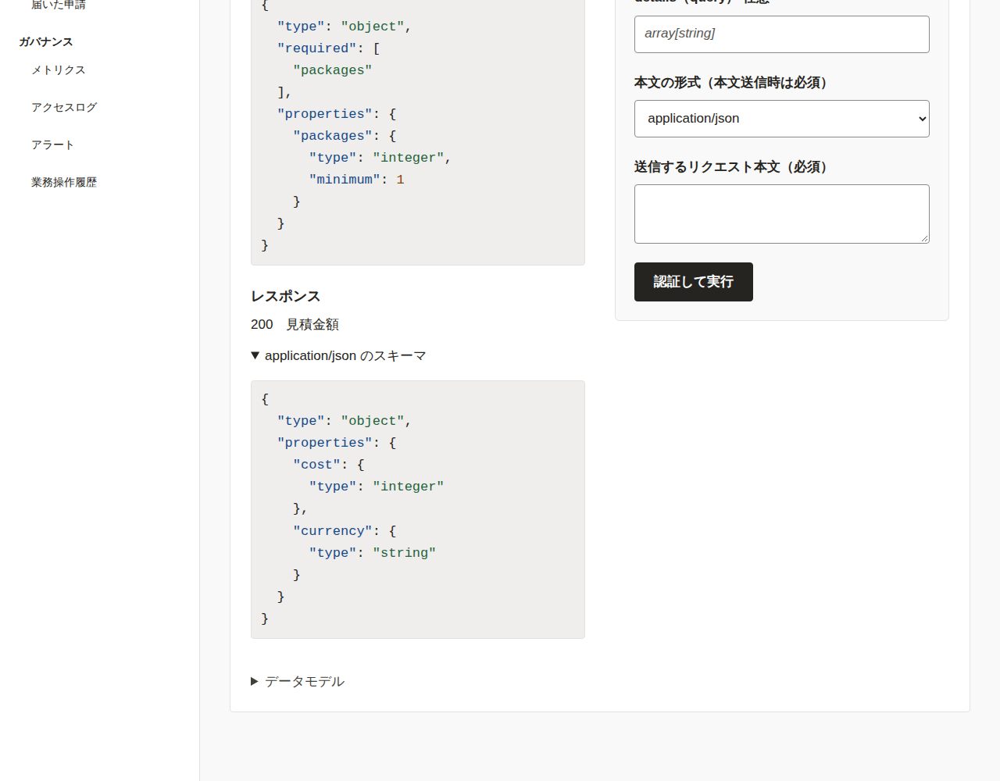
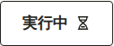

# 利用者は、API操作を試すとき、API Docsから呼び出しできる

判定　合格

対象コミット　`7cad9c4bc476d8d01f322dba83ac9f6c975bcd4d`

[検証した要件と変更履歴](https://github.com/tsuji-tomonori/tsugite-api/blob/7cad9c4bc476d8d01f322dba83ac9f6c975bcd4d/docs/requirements/items/%E5%88%A9%E7%94%A8%E8%80%85%E3%81%AF%E3%80%81API%E6%93%8D%E4%BD%9C%E3%82%92%E8%A9%A6%E3%81%99%E3%81%A8%E3%81%8D%E3%80%81API%20Docs%E3%81%8B%E3%82%89%E5%91%BC%E3%81%B3%E5%87%BA%E3%81%97%E3%81%A7%E3%81%8D%E3%82%8B.md)

## 実行したテストと証跡

- 成功　参照先のJSONでキーと各値を色分けし、引用符・タグ文字・改行を含む原文を保持する。（0.004 秒）　`packages/frontend/tests/test_components.py::test_schema_block_preserves_json_tokens`
- 成功　OpenAPIの型からパス・クエリ・JSONを入力し、選択したキーでHTTPSの送料計算を実行する（9.372 秒）　`tests/e2e/browser/test_api_docs.py::test_openapi_key_console`
  - 
- 成功　API Docsの交換フォームで未対応の方式や種別を指定したとき、短期トークンを発行しない。（トークン交換以外の方式は入力エラーとして返す）（0.147 秒）　`packages/backend/tests/test_required_credentials.py::test_oauth_exchange_form_accepts_only_documented_token_types[different-grant]`
- 成功　API Docsの交換フォームで未対応の方式や種別を指定したとき、短期トークンを発行しない。（交換元の種類にIDトークンを選んだフォームを拒否する）（0.157 秒）　`packages/backend/tests/test_required_credentials.py::test_oauth_exchange_form_accepts_only_documented_token_types[id-token-kind]`
- 成功　API Docsの交換フォームで未対応の方式や種別を指定したとき、短期トークンを発行しない。（アクセストークン以外の応答種別を指定したフォームを拒否する）（0.147 秒）　`packages/backend/tests/test_required_credentials.py::test_oauth_exchange_form_accepts_only_documented_token_types[unsupported-result]`
- 成功　操作を押すと選択した環境とプロジェクトへ認証付きで送り、応答・照合ID・コピー用curlを表示する。（既存の認証情報を使って短期トークンで実行する）（0.009 秒）　`packages/frontend/tests/test_required_product_trial.py::test_api_docs_runs_and_copies_curl[existing]`
- 成功　操作を押すと選択した環境とプロジェクトへ認証付きで送り、応答・照合ID・コピー用curlを表示する。（初回の実行で商品専用の認証情報を発行する）（0.007 秒）　`packages/frontend/tests/test_required_product_trial.py::test_api_docs_runs_and_copies_curl[first-use]`
- 成功　OpenAPIの型からパス・クエリ・JSONを入力し、選択したキーでHTTPSの送料計算を実行する（9.372 秒）　`tests/e2e/browser/test_api_docs.py::test_openapi_key_console`
  - 
- 成功　OpenAPIの型からパス・クエリ・JSONを入力し、選択したキーでHTTPSの送料計算を実行する（9.372 秒）　`tests/e2e/browser/test_api_docs.py::test_openapi_key_console`
  - 
- 成功　本人、別人、共有キーとマシンの権利を区別し、停止・失効を即時反映する。（形式仕様の操作と期待状態を照合する。）（0.001 秒）　`packages/backend/tests/test_quint_policy.py::test_entitlement_policy[entitlement.principalTest]`
- 成功　本人、別人、共有キーとマシンの権利を区別し、停止・失効を即時反映する。（形式仕様の操作と期待状態を照合する。）（0.001 秒）　`packages/backend/tests/test_quint_policy.py::test_entitlement_policy[entitlement.stopTest]`
- 成功　承認済み環境だけを表示し、同時実行でも同じ商品の個人認証情報を再利用する。（0.004 秒）　`packages/frontend/tests/test_api_client.py::test_trial_uses_approved_environments_and_reuses_personal_credential`

[テスト実行記録（JUnit XML）](%E5%88%A9%E7%94%A8%E8%80%85%E3%81%AF%E3%80%81API%E6%93%8D%E4%BD%9C%E3%82%92%E8%A9%A6%E3%81%99%E3%81%A8%E3%81%8D%E3%80%81API%20Docs%E3%81%8B%E3%82%89%E5%91%BC%E3%81%B3%E5%87%BA%E3%81%97%E3%81%A7%E3%81%8D%E3%82%8B.xml)
