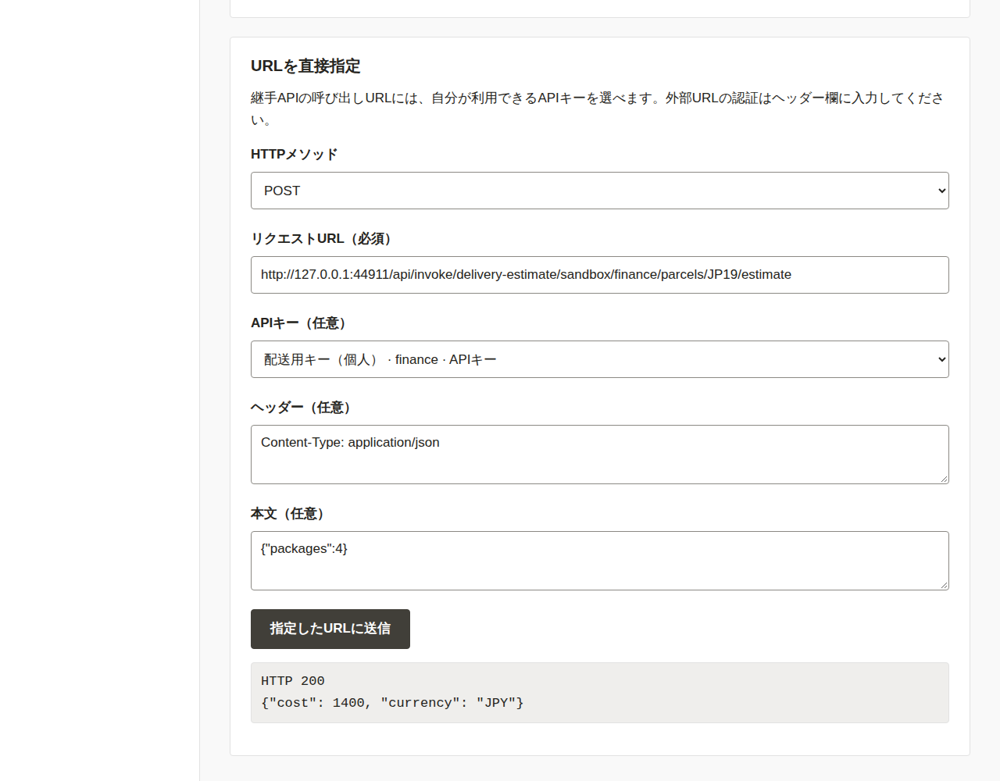

# 利用者は、URLを直接指定するとき、利用できるAPIキーを選択して呼び出すことができる

判定　合格

対象コミット　`5d20e41ce9a4f08afbccdf5c274e1ff2f859cc17`

[検証した要件と変更履歴](https://github.com/tsuji-tomonori/tsugite-api/blob/5d20e41ce9a4f08afbccdf5c274e1ff2f859cc17/docs/requirements/items/%E5%88%A9%E7%94%A8%E8%80%85%E3%81%AF%E3%80%81URL%E3%82%92%E7%9B%B4%E6%8E%A5%E6%8C%87%E5%AE%9A%E3%81%99%E3%82%8B%E3%81%A8%E3%81%8D%E3%80%81%E5%88%A9%E7%94%A8%E3%81%A7%E3%81%8D%E3%82%8BAPI%E3%82%AD%E3%83%BC%E3%82%92%E9%81%B8%E6%8A%9E%E3%81%97%E3%81%A6%E5%91%BC%E3%81%B3%E5%87%BA%E3%81%99%E3%81%93%E3%81%A8%E3%81%8C%E3%81%A7%E3%81%8D%E3%82%8B.md)

## 実行したテストと証跡

- 成功　本人の有効な個人キーと利用可能な共有キーだけを候補にする。（0.001 秒）　`packages/frontend/tests/test_api_client.py::test_manual_key_eligibility`
- 成功　キーを選ぶと呼び出しURLと認証ヘッダーの重複を確認してから、選択したキーを交換する。（0.003 秒）　`packages/frontend/tests/test_api_client.py::test_manual_key_checks_destination_before_exchange`
- 成功　従来キーは本人がログインしている場合だけキーIDと本人のトークンで送信する。（0.002 秒）　`packages/frontend/tests/test_api_client.py::test_manual_legacy_key_uses_id`
- 成功　OpenAPIの型からパス・クエリ・JSONを入力し、選択したキーでHTTPSの送料計算を実行する（8.713 秒）　`tests/e2e/browser/test_api_docs.py::test_openapi_key_console`
  - 

[テスト実行記録（JUnit XML）](%E5%88%A9%E7%94%A8%E8%80%85%E3%81%AF%E3%80%81URL%E3%82%92%E7%9B%B4%E6%8E%A5%E6%8C%87%E5%AE%9A%E3%81%99%E3%82%8B%E3%81%A8%E3%81%8D%E3%80%81%E5%88%A9%E7%94%A8%E3%81%A7%E3%81%8D%E3%82%8BAPI%E3%82%AD%E3%83%BC%E3%82%92%E9%81%B8%E6%8A%9E%E3%81%97%E3%81%A6%E5%91%BC%E3%81%B3%E5%87%BA%E3%81%99%E3%81%93%E3%81%A8%E3%81%8C%E3%81%A7%E3%81%8D%E3%82%8B.xml)
