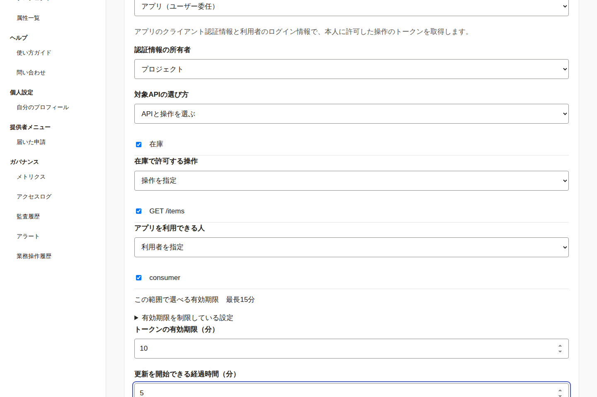

# 利用者は、アクセストークンを発行するとき、有効期間と更新開始時刻を指定できる

判定　合格

対象コミット　`01130309252051badc6cb01f91b2a33a407ed01c`

## 実行したテストと証跡

- 成功　ブラウザーで3方式を発行し、実時計で1分後に更新、シークレット変更・失効まで確認する（68.293 秒）　`tests/e2e/browser/test_credentials_console.py::test_credentials_console`
  - 
- 成功　提供者・部署・プロジェクトの上限、更新と失効の秒境界、発行後の上限短縮を確認する（0.518 秒）　`packages/backend/tests/test_credential_lifecycle.py::test_nested_token_lifetime`

[テスト実行記録（JUnit XML）](%E5%88%A9%E7%94%A8%E8%80%85%E3%81%AF%E3%80%81%E3%82%A2%E3%82%AF%E3%82%BB%E3%82%B9%E3%83%88%E3%83%BC%E3%82%AF%E3%83%B3%E3%82%92%E7%99%BA%E8%A1%8C%E3%81%99%E3%82%8B%E3%81%A8%E3%81%8D%E3%80%81%E6%9C%89%E5%8A%B9%E6%9C%9F%E9%96%93%E3%81%A8%E6%9B%B4%E6%96%B0%E9%96%8B%E5%A7%8B%E6%99%82%E5%88%BB%E3%82%92%E6%8C%87%E5%AE%9A%E3%81%A7%E3%81%8D%E3%82%8B.xml)
