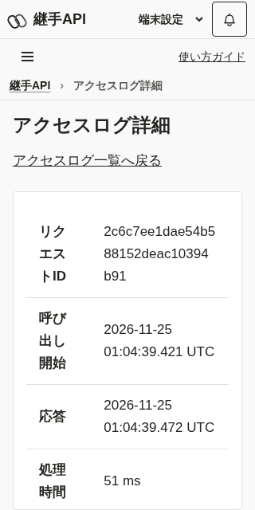

# 利用者は、アクセスログを調べるとき、リクエストIDを指定して問い合わせできる

判定　合格

対象コミット　`15609cdd6e473e51afde3c0c502761ffab0f1acb`

[検証した要件と変更履歴](https://github.com/tsuji-tomonori/tsugite-api/blob/15609cdd6e473e51afde3c0c502761ffab0f1acb/docs/requirements/items/%E5%88%A9%E7%94%A8%E8%80%85%E3%81%AF%E3%80%81%E3%82%A2%E3%82%AF%E3%82%BB%E3%82%B9%E3%83%AD%E3%82%B0%E3%82%92%E8%AA%BF%E3%81%B9%E3%82%8B%E3%81%A8%E3%81%8D%E3%80%81%E3%83%AA%E3%82%AF%E3%82%A8%E3%82%B9%E3%83%88ID%E3%82%92%E6%8C%87%E5%AE%9A%E3%81%97%E3%81%A6%E5%95%8F%E3%81%84%E5%90%88%E3%82%8F%E3%81%9B%E3%81%A7%E3%81%8D%E3%82%8B.md)

## 実行したテストと証跡

- 成功　利用者が2ページ目の1件を開き、同じリクエストIDで質問と問い合わせを送れる。（9.058 秒）　`tests/e2e/browser/test_requirement_flows.py::test_access_log_detail_and_support`
  - 

[テスト実行記録（JUnit XML）](%E5%88%A9%E7%94%A8%E8%80%85%E3%81%AF%E3%80%81%E3%82%A2%E3%82%AF%E3%82%BB%E3%82%B9%E3%83%AD%E3%82%B0%E3%82%92%E8%AA%BF%E3%81%B9%E3%82%8B%E3%81%A8%E3%81%8D%E3%80%81%E3%83%AA%E3%82%AF%E3%82%A8%E3%82%B9%E3%83%88ID%E3%82%92%E6%8C%87%E5%AE%9A%E3%81%97%E3%81%A6%E5%95%8F%E3%81%84%E5%90%88%E3%82%8F%E3%81%9B%E3%81%A7%E3%81%8D%E3%82%8B.xml)
