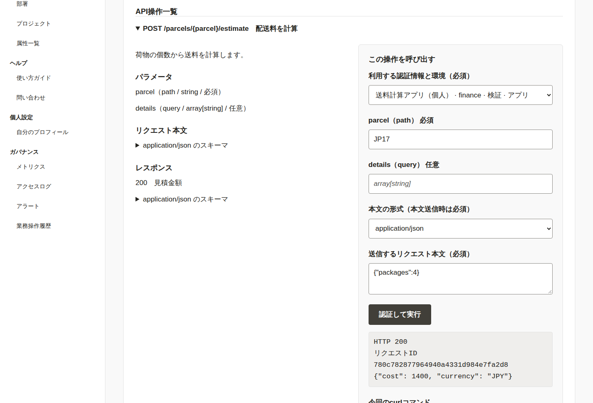

# 利用者は、アプリ認証を発行するとき、API操作を限定できる

判定　合格

対象コミット　`e77afc4a3eda88a0cba4fd2035ecaa9b1cd3bd8c`

[検証した要件と変更履歴](https://github.com/tsuji-tomonori/tsugite-api/blob/e77afc4a3eda88a0cba4fd2035ecaa9b1cd3bd8c/docs/requirements/items/%E5%88%A9%E7%94%A8%E8%80%85%E3%81%AF%E3%80%81%E3%82%A2%E3%83%97%E3%83%AA%E8%AA%8D%E8%A8%BC%E3%82%92%E7%99%BA%E8%A1%8C%E3%81%99%E3%82%8B%E3%81%A8%E3%81%8D%E3%80%81API%E6%93%8D%E4%BD%9C%E3%82%92%E9%99%90%E5%AE%9A%E3%81%A7%E3%81%8D%E3%82%8B.md)

## 実行したテストと証跡

- 成功　提供者が利用者の操作を選び、送料1,400円のHTTPS応答と権限変更直後の転送停止を照合する（10.834 秒）　`tests/e2e/browser/test_operation_console.py::test_person_operation_console`
  - 
- 成功　AWS EmulatorのCognito利用者とシステムのトークンを発行し、HTTPS到達・拒否・秘密更新を確認する（7.734 秒）　`tests/e2e/aws/test_credential_tokens.py::test_client_tokens_reach_https`
- 成功　認証情報と利用者の操作制限、世代、発行後の秒境界を照合する。（形式仕様の操作と期待状態を照合する。）（0.001 秒）　`packages/backend/tests/test_quint_policy.py::test_operation_policy[credentials.lifetimeTest]`
- 成功　認証情報と利用者の操作制限、世代、発行後の秒境界を照合する。（形式仕様の操作と期待状態を照合する。）（0.000 秒）　`packages/backend/tests/test_quint_policy.py::test_operation_policy[credentials.operationsTest]`
- 成功　認証情報と利用者の操作制限、世代、発行後の秒境界を照合する。（形式仕様の操作と期待状態を照合する。）（0.000 秒）　`packages/backend/tests/test_quint_policy.py::test_operation_policy[credentials.rotatedTest]`

[テスト実行記録（JUnit XML）](%E5%88%A9%E7%94%A8%E8%80%85%E3%81%AF%E3%80%81%E3%82%A2%E3%83%97%E3%83%AA%E8%AA%8D%E8%A8%BC%E3%82%92%E7%99%BA%E8%A1%8C%E3%81%99%E3%82%8B%E3%81%A8%E3%81%8D%E3%80%81API%E6%93%8D%E4%BD%9C%E3%82%92%E9%99%90%E5%AE%9A%E3%81%A7%E3%81%8D%E3%82%8B.xml)
