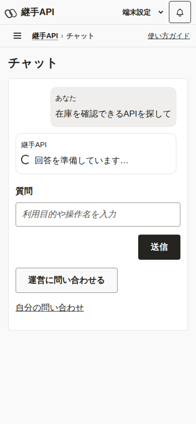

# 利用者は、チャットで回答を待つとき、処理中であることを確認できる

判定　合格

対象コミット　`e7804a0c129717485df3c009b4b6cd620cf393a7`

[検証した要件と変更履歴](https://github.com/tsuji-tomonori/tsugite-api/blob/e7804a0c129717485df3c009b4b6cd620cf393a7/docs/requirements/items/%E5%88%A9%E7%94%A8%E8%80%85%E3%81%AF%E3%80%81%E3%83%81%E3%83%A3%E3%83%83%E3%83%88%E3%81%A7%E5%9B%9E%E7%AD%94%E3%82%92%E5%BE%85%E3%81%A4%E3%81%A8%E3%81%8D%E3%80%81%E5%87%A6%E7%90%86%E4%B8%AD%E3%81%A7%E3%81%82%E3%82%8B%E3%81%93%E3%81%A8%E3%82%92%E7%A2%BA%E8%AA%8D%E3%81%A7%E3%81%8D%E3%82%8B.md)

## 実行したテストと証跡

- 成功　ログイン直後のチャットで商品と手順を調べ、運営への問い合わせを明示的に送信できる。（4.726 秒）　`tests/e2e/browser/test_portal.py::test_home_chat_and_inquiry`
  - 
- 成功　回答の作成中は送信を無効にし、同じ質問を二重受付せずに結果を表示する。（0.004 秒）　`packages/frontend/tests/test_required_guide_home.py::test_waiting_for_a_chat_answer_prevents_a_second_submission`

[テスト実行記録（JUnit XML）](%E5%88%A9%E7%94%A8%E8%80%85%E3%81%AF%E3%80%81%E3%83%81%E3%83%A3%E3%83%83%E3%83%88%E3%81%A7%E5%9B%9E%E7%AD%94%E3%82%92%E5%BE%85%E3%81%A4%E3%81%A8%E3%81%8D%E3%80%81%E5%87%A6%E7%90%86%E4%B8%AD%E3%81%A7%E3%81%82%E3%82%8B%E3%81%93%E3%81%A8%E3%82%92%E7%A2%BA%E8%AA%8D%E3%81%A7%E3%81%8D%E3%82%8B.xml)
