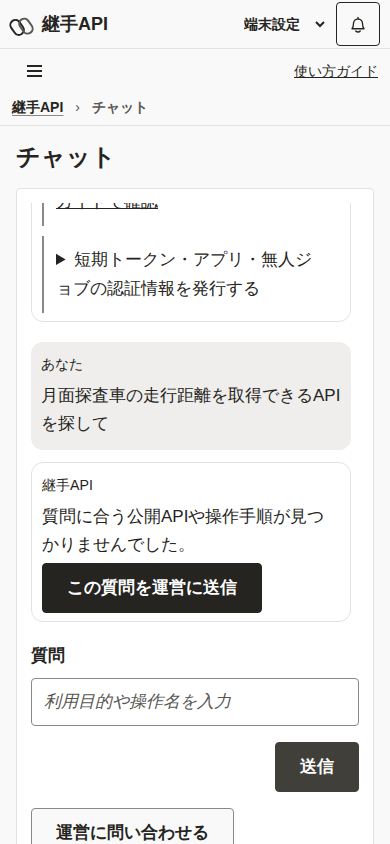

# 利用者は、チャットで質問に合う候補がないとき、元の質問を問い合わせとして送信できる

判定　合格

対象コミット　`7cad9c4bc476d8d01f322dba83ac9f6c975bcd4d`

[検証した要件と変更履歴](https://github.com/tsuji-tomonori/tsugite-api/blob/7cad9c4bc476d8d01f322dba83ac9f6c975bcd4d/docs/requirements/items/%E5%88%A9%E7%94%A8%E8%80%85%E3%81%AF%E3%80%81%E3%83%81%E3%83%A3%E3%83%83%E3%83%88%E3%81%A7%E8%B3%AA%E5%95%8F%E3%81%AB%E5%90%88%E3%81%86%E5%80%99%E8%A3%9C%E3%81%8C%E3%81%AA%E3%81%84%E3%81%A8%E3%81%8D%E3%80%81%E5%85%83%E3%81%AE%E8%B3%AA%E5%95%8F%E3%82%92%E5%95%8F%E3%81%84%E5%90%88%E3%82%8F%E3%81%9B%E3%81%A8%E3%81%97%E3%81%A6%E9%80%81%E4%BF%A1%E3%81%A7%E3%81%8D%E3%82%8B.md)

## 実行したテストと証跡

- 成功　ログイン直後のチャットで商品と手順を調べ、運営への問い合わせを明示的に送信できる。（6.281 秒）　`tests/e2e/browser/test_portal.py::test_home_chat_and_inquiry`
  - 
- 成功　モデルが全資料を同順位にしても、該当なしを返し、一致する質問では該当商品だけを示す。（0.002 秒）　`packages/agent/tests/test_agent_retrieval.py::test_chat_does_not_promote_unrelated_sources`
- 成功　回答できなかった質問を個別に送信でき、失敗後に再送しても受付は一度である。（該当なしの質問を引き継ぐ。）（0.005 秒）　`packages/frontend/tests/test_required_guide_home.py::test_unanswered_turn_sends_its_own_question_once[empty]`
- 成功　回答できなかった質問を個別に送信でき、失敗後に再送しても受付は一度である。（案内範囲外の質問を引き継ぐ。）（0.006 秒）　`packages/frontend/tests/test_required_guide_home.py::test_unanswered_turn_sends_its_own_question_once[outside]`
- 成功　過去分の推定時刻と実測時刻を区別し、質問には選んだ記録の結果と識別子で答える。（0.004 秒）　`packages/frontend/tests/test_access_log_detail.py::test_detail_timestamps_and_answers`
- 成功　同じ受付番号で再送しても一件に保ち、他人の回答を拒み管理者の回答を本人に表示する。（形式仕様の操作と期待状態を照合する。）（0.271 秒）　`packages/backend/tests/test_quint_governance.py::test_private_inquiry_history[inquiries.inquiryTest]`

[テスト実行記録（JUnit XML）](%E5%88%A9%E7%94%A8%E8%80%85%E3%81%AF%E3%80%81%E3%83%81%E3%83%A3%E3%83%83%E3%83%88%E3%81%A7%E8%B3%AA%E5%95%8F%E3%81%AB%E5%90%88%E3%81%86%E5%80%99%E8%A3%9C%E3%81%8C%E3%81%AA%E3%81%84%E3%81%A8%E3%81%8D%E3%80%81%E5%85%83%E3%81%AE%E8%B3%AA%E5%95%8F%E3%82%92%E5%95%8F%E3%81%84%E5%90%88%E3%82%8F%E3%81%9B%E3%81%A8%E3%81%97%E3%81%A6%E9%80%81%E4%BF%A1%E3%81%A7%E3%81%8D%E3%82%8B.xml)
