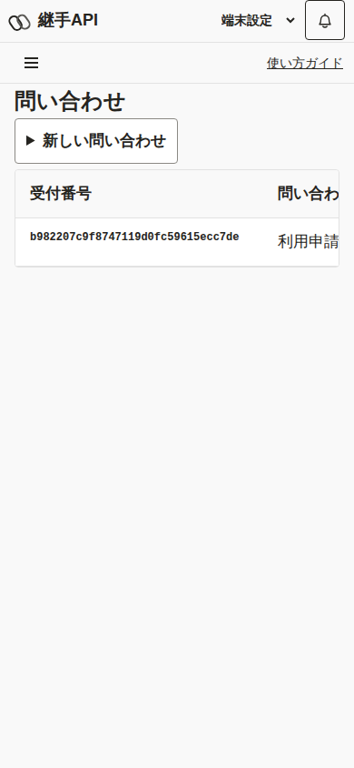

# 利用者は、チャットの案内で解決しないとき、問い合わせを送信できる

判定　合格

対象コミット　`eb58d72252bc5cbfdc0c62506b047798636d428f`

[検証した要件と変更履歴](https://github.com/tsuji-tomonori/tsugite-api/blob/eb58d72252bc5cbfdc0c62506b047798636d428f/docs/requirements/items/%E5%88%A9%E7%94%A8%E8%80%85%E3%81%AF%E3%80%81%E3%83%81%E3%83%A3%E3%83%83%E3%83%88%E3%81%AE%E6%A1%88%E5%86%85%E3%81%A7%E8%A7%A3%E6%B1%BA%E3%81%97%E3%81%AA%E3%81%84%E3%81%A8%E3%81%8D%E3%80%81%E5%95%8F%E3%81%84%E5%90%88%E3%82%8F%E3%81%9B%E3%82%92%E9%80%81%E4%BF%A1%E3%81%A7%E3%81%8D%E3%82%8B.md)

## 実行したテストと証跡

- 成功　ホームで商品と手順を調べ、運営への問い合わせを明示的に送信できる。（7.009 秒）　`tests/e2e/browser/test_portal.py::test_home_chat_and_inquiry`
  - 
- 成功　問い合わせの案内だけでは未送信で、送信後の回答は本人と管理者にだけ表示する。（0.157 秒）　`packages/backend/tests/test_chat_api.py::test_inquiry_requires_explicit_submission_and_private_reply`

[テスト実行記録（JUnit XML）](%E5%88%A9%E7%94%A8%E8%80%85%E3%81%AF%E3%80%81%E3%83%81%E3%83%A3%E3%83%83%E3%83%88%E3%81%AE%E6%A1%88%E5%86%85%E3%81%A7%E8%A7%A3%E6%B1%BA%E3%81%97%E3%81%AA%E3%81%84%E3%81%A8%E3%81%8D%E3%80%81%E5%95%8F%E3%81%84%E5%90%88%E3%82%8F%E3%81%9B%E3%82%92%E9%80%81%E4%BF%A1%E3%81%A7%E3%81%8D%E3%82%8B.xml)
