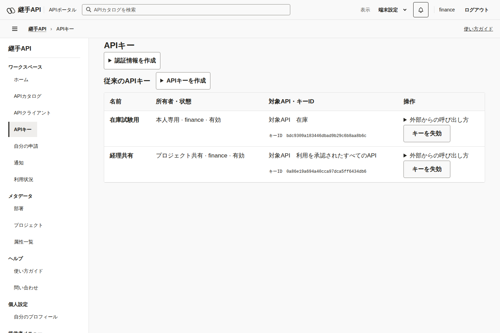

# 利用者は、プロジェクトで認証情報を使い分けるとき、APIキーを発行できる

判定　合格

対象コミット　`eb58d72252bc5cbfdc0c62506b047798636d428f`

[検証した要件と変更履歴](https://github.com/tsuji-tomonori/tsugite-api/blob/eb58d72252bc5cbfdc0c62506b047798636d428f/docs/requirements/items/%E5%88%A9%E7%94%A8%E8%80%85%E3%81%AF%E3%80%81%E3%83%97%E3%83%AD%E3%82%B8%E3%82%A7%E3%82%AF%E3%83%88%E3%81%A7%E8%AA%8D%E8%A8%BC%E6%83%85%E5%A0%B1%E3%82%92%E4%BD%BF%E3%81%84%E5%88%86%E3%81%91%E3%82%8B%E3%81%A8%E3%81%8D%E3%80%81API%E3%82%AD%E3%83%BC%E3%82%92%E7%99%BA%E8%A1%8C%E3%81%A7%E3%81%8D%E3%82%8B.md)

## 実行したテストと証跡

- 成功　管理者が組織階層と兼務を設定し、リーダーがキー・利用状況・停止と再開を操作する（12.543 秒）　`tests/e2e/browser/test_workspace_console.py::test_workspace_key_console`
  - 
- 成功　EmulatorのCognitoと共有・本人キーでHTTPS接続先を呼び、別人・範囲外・失効を拒否する（2.539 秒）　`tests/e2e/aws/test_scoped_keys.py::test_scoped_keys_reach_https`

[テスト実行記録（JUnit XML）](%E5%88%A9%E7%94%A8%E8%80%85%E3%81%AF%E3%80%81%E3%83%97%E3%83%AD%E3%82%B8%E3%82%A7%E3%82%AF%E3%83%88%E3%81%A7%E8%AA%8D%E8%A8%BC%E6%83%85%E5%A0%B1%E3%82%92%E4%BD%BF%E3%81%84%E5%88%86%E3%81%91%E3%82%8B%E3%81%A8%E3%81%8D%E3%80%81API%E3%82%AD%E3%83%BC%E3%82%92%E7%99%BA%E8%A1%8C%E3%81%A7%E3%81%8D%E3%82%8B.xml)
