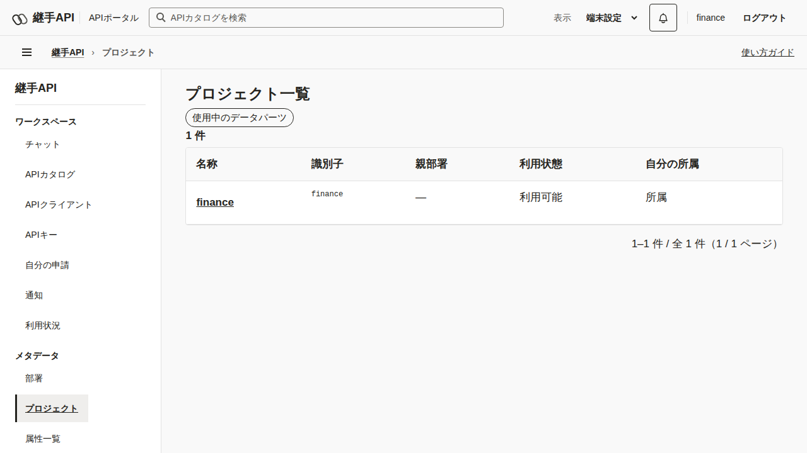

# 利用者は、プロジェクトの一覧を開いたとき、自分が所属するプロジェクトを確認できる

判定　合格

対象コミット　`44976472fbf53461052e4e879e7f140efc8ae599`

[検証した要件と変更履歴](https://github.com/tsuji-tomonori/tsugite-api/blob/44976472fbf53461052e4e879e7f140efc8ae599/docs/requirements/items/%E5%88%A9%E7%94%A8%E8%80%85%E3%81%AF%E3%80%81%E3%83%97%E3%83%AD%E3%82%B8%E3%82%A7%E3%82%AF%E3%83%88%E3%81%AE%E4%B8%80%E8%A6%A7%E3%82%92%E9%96%8B%E3%81%84%E3%81%9F%E3%81%A8%E3%81%8D%E3%80%81%E8%87%AA%E5%88%86%E3%81%8C%E6%89%80%E5%B1%9E%E3%81%99%E3%82%8B%E3%83%97%E3%83%AD%E3%82%B8%E3%82%A7%E3%82%AF%E3%83%88%E3%82%92%E7%A2%BA%E8%AA%8D%E3%81%A7%E3%81%8D%E3%82%8B.md)

## 実行したテストと証跡

- 成功　finance の利用者には所属先が1件だけ表示され、未所属の詳細URLを開いても情報は表示されない（5.822 秒）　`tests/e2e/browser/test_workspace_console.py::test_consumer_project_directory`
  - 

[テスト実行記録（JUnit XML）](%E5%88%A9%E7%94%A8%E8%80%85%E3%81%AF%E3%80%81%E3%83%97%E3%83%AD%E3%82%B8%E3%82%A7%E3%82%AF%E3%83%88%E3%81%AE%E4%B8%80%E8%A6%A7%E3%82%92%E9%96%8B%E3%81%84%E3%81%9F%E3%81%A8%E3%81%8D%E3%80%81%E8%87%AA%E5%88%86%E3%81%8C%E6%89%80%E5%B1%9E%E3%81%99%E3%82%8B%E3%83%97%E3%83%AD%E3%82%B8%E3%82%A7%E3%82%AF%E3%83%88%E3%82%92%E7%A2%BA%E8%AA%8D%E3%81%A7%E3%81%8D%E3%82%8B.xml)
