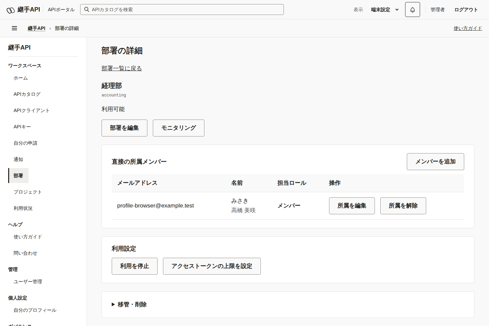

# 利用者は、プロフィールを開いたとき、氏名と表示名を変更できる

判定　合格

対象コミット　`7cad9c4bc476d8d01f322dba83ac9f6c975bcd4d`

[検証した要件と変更履歴](https://github.com/tsuji-tomonori/tsugite-api/blob/7cad9c4bc476d8d01f322dba83ac9f6c975bcd4d/docs/requirements/items/%E5%88%A9%E7%94%A8%E8%80%85%E3%81%AF%E3%80%81%E3%83%97%E3%83%AD%E3%83%95%E3%82%A3%E3%83%BC%E3%83%AB%E3%82%92%E9%96%8B%E3%81%84%E3%81%9F%E3%81%A8%E3%81%8D%E3%80%81%E6%B0%8F%E5%90%8D%E3%81%A8%E8%A1%A8%E7%A4%BA%E5%90%8D%E3%82%92%E5%A4%89%E6%9B%B4%E3%81%A7%E3%81%8D%E3%82%8B.md)

## 実行したテストと証跡

- 成功　ユーザー名と氏名のどちらかが欠落または空なら招待を拒否し、両方を指定したときだけ登録する。（0.190 秒）　`packages/backend/tests/test_member_profiles.py::test_invitation_requires_login_and_full_name`
- 成功　プロジェクト単位の集計であることを案内し、所属メンバーをユーザー名と氏名を含む表で表示する。（0.026 秒）　`packages/frontend/tests/test_workspace_screens.py::test_project_monitor_shows_members_as_a_table`
- 成功　管理者が所属候補を読み込むと、追加の登録ユーザーを対象組織の所属先に選べる。（0.005 秒）　`packages/frontend/tests/test_required_people_workspace.py::test_load_more_candidates_for_membership`
- 成功　管理者が招待時に氏名を入力し、本人の表示名とともに兼務先に表示して監査を確認する。（9.267 秒）　`tests/e2e/browser/test_member_profile_console.py::test_member_profile_management`
  - 
- 成功　AWS Emulatorで氏名付き招待と本人編集を行い、Cognitoの識別子とトークンが継続して使える。（2.711 秒）　`tests/e2e/aws/test_portal.py::test_cognito_member_lifecycle`
- 成功　本人と全体管理者の変更を兼務先に反映し、IDと監査の閲覧範囲を保持する。（0.363 秒）　`packages/backend/tests/test_member_profiles.py::test_profile_edits_filter_directory_and_audit`
- 成功　本人と管理者が名前を更新し、第三者と旧版の書き込みが既存の値を変えない。（形式仕様の操作と期待状態を照合する。）（0.534 秒）　`packages/backend/tests/test_quint_governance.py::test_profile_history[profiles.profileTest]`
- 成功　本人と管理者が名前を更新し、第三者と旧版の書き込みが既存の値を変えない。（形式仕様の操作と期待状態を照合する。）（0.203 秒）　`packages/backend/tests/test_quint_governance.py::test_profile_history[profiles.requiredFullNameTest]`

[テスト実行記録（JUnit XML）](%E5%88%A9%E7%94%A8%E8%80%85%E3%81%AF%E3%80%81%E3%83%97%E3%83%AD%E3%83%95%E3%82%A3%E3%83%BC%E3%83%AB%E3%82%92%E9%96%8B%E3%81%84%E3%81%9F%E3%81%A8%E3%81%8D%E3%80%81%E6%B0%8F%E5%90%8D%E3%81%A8%E8%A1%A8%E7%A4%BA%E5%90%8D%E3%82%92%E5%A4%89%E6%9B%B4%E3%81%A7%E3%81%8D%E3%82%8B.xml)
