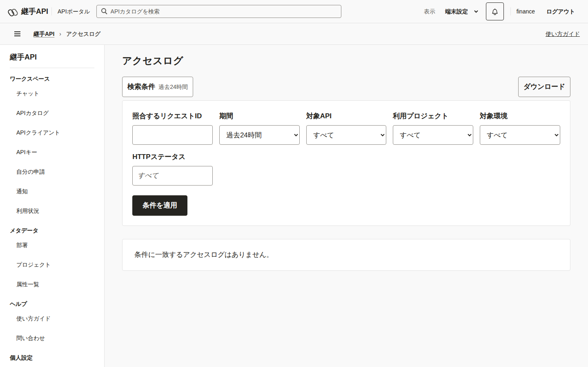
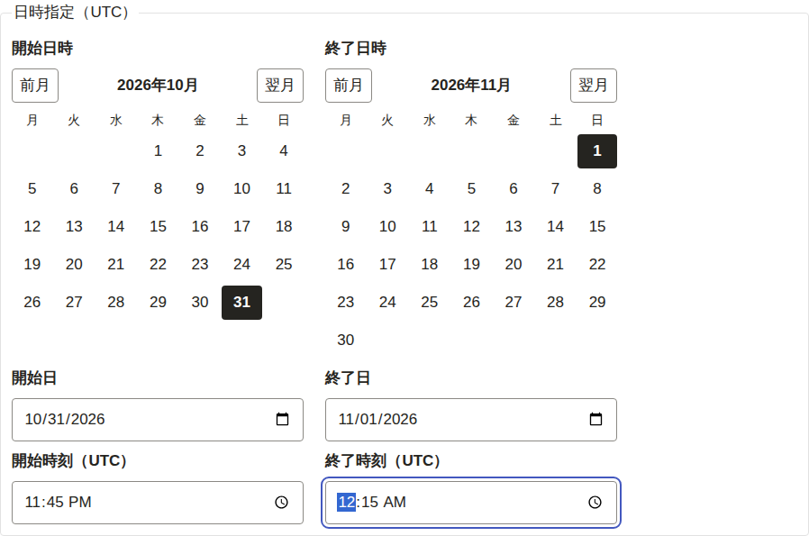
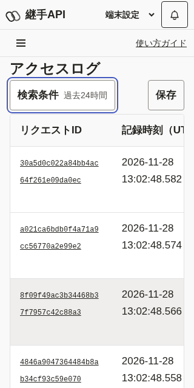

# 利用者は、ポータルで一覧を開いたとき、アクセスログの結果表をすぐに確認できる

判定　合格

対象コミット　`d9f31e9b0159ab947c37778704413fe3714d504a`

[検証した要件と変更履歴](https://github.com/tsuji-tomonori/tsugite-api/blob/d9f31e9b0159ab947c37778704413fe3714d504a/docs/requirements/items/%E5%88%A9%E7%94%A8%E8%80%85%E3%81%AF%E3%80%81%E3%83%9D%E3%83%BC%E3%82%BF%E3%83%AB%E3%81%A7%E4%B8%80%E8%A6%A7%E3%82%92%E9%96%8B%E3%81%84%E3%81%9F%E3%81%A8%E3%81%8D%E3%80%81%E3%82%A2%E3%82%AF%E3%82%BB%E3%82%B9%E3%83%AD%E3%82%B0%E3%81%AE%E7%B5%90%E6%9E%9C%E8%A1%A8%E3%82%92%E3%81%99%E3%81%90%E3%81%AB%E7%A2%BA%E8%AA%8D%E3%81%A7%E3%81%8D%E3%82%8B.md)

## 実行したテストと証跡

- 成功　6種類の権限で全メニューを開き、狭幅と広幅で余白・操作領域・横あふれを検査する。（111.017 秒）　`tests/e2e/browser/test_layout.py::test_role_screen_layout`
  - 
- 成功　月をまたぐ日付の選択・時刻の直接入力・不正な期間の修正・相対期間への復帰を確認する。（7.144 秒）　`tests/e2e/browser/test_requirement_flows.py::test_access_log_calendar_period`
  - 
- 成功　利用者が2ページ目の1件を開き、同じリクエストIDで質問と問い合わせを送れる。（10.529 秒）　`tests/e2e/browser/test_requirement_flows.py::test_access_log_detail_and_support`
  - 
- 成功　アクセスログ一覧の検索条件は閉じた状態で、結果表には記録と詳細へのリンクを表示する。（0.015 秒）　`packages/frontend/tests/test_required_people_logs.py::test_access_log_table_initial_disclosure`

[テスト実行記録（JUnit XML）](%E5%88%A9%E7%94%A8%E8%80%85%E3%81%AF%E3%80%81%E3%83%9D%E3%83%BC%E3%82%BF%E3%83%AB%E3%81%A7%E4%B8%80%E8%A6%A7%E3%82%92%E9%96%8B%E3%81%84%E3%81%9F%E3%81%A8%E3%81%8D%E3%80%81%E3%82%A2%E3%82%AF%E3%82%BB%E3%82%B9%E3%83%AD%E3%82%B0%E3%81%AE%E7%B5%90%E6%9E%9C%E8%A1%A8%E3%82%92%E3%81%99%E3%81%90%E3%81%AB%E7%A2%BA%E8%AA%8D%E3%81%A7%E3%81%8D%E3%82%8B.xml)
