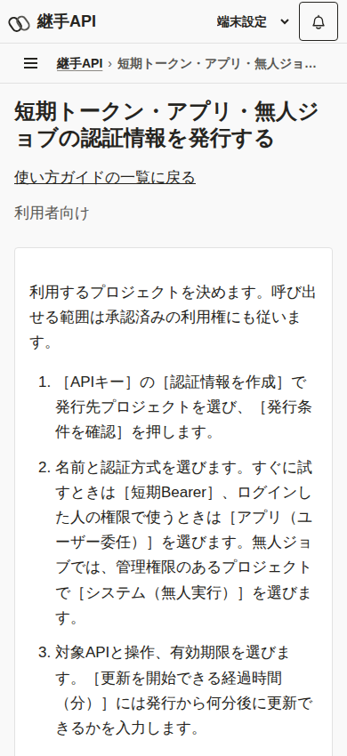

# 利用者は、ポータルの操作に迷ったとき、使い方ガイドを検索できる

判定　合格

対象コミット　`6ea13b6727fccc012bd33ea31a29b99858f4967b`

[検証した要件と変更履歴](https://github.com/tsuji-tomonori/tsugite-api/blob/6ea13b6727fccc012bd33ea31a29b99858f4967b/docs/requirements/items/%E5%88%A9%E7%94%A8%E8%80%85%E3%81%AF%E3%80%81%E3%83%9D%E3%83%BC%E3%82%BF%E3%83%AB%E3%81%AE%E6%93%8D%E4%BD%9C%E3%81%AB%E8%BF%B7%E3%81%A3%E3%81%9F%E3%81%A8%E3%81%8D%E3%80%81%E4%BD%BF%E3%81%84%E6%96%B9%E3%82%AC%E3%82%A4%E3%83%89%E3%82%92%E6%A4%9C%E7%B4%A2%E3%81%A7%E3%81%8D%E3%82%8B.md)

## 実行したテストと証跡

- 成功　ガイド一覧の各手順は操作後の確認方法と入力できない画面例を持ち、対象画面を案内する。（0.131 秒）　`packages/frontend/tests/test_required_guide.py::test_every_guide_has_an_inert_example_and_ordered_steps`
- 成功　役割と検索語で使い方を絞り込み、手順から対象画面を開ける（13.946 秒）　`tests/e2e/browser/test_usage_guide.py::test_usage_guide`
  - 

[テスト実行記録（JUnit XML）](%E5%88%A9%E7%94%A8%E8%80%85%E3%81%AF%E3%80%81%E3%83%9D%E3%83%BC%E3%82%BF%E3%83%AB%E3%81%AE%E6%93%8D%E4%BD%9C%E3%81%AB%E8%BF%B7%E3%81%A3%E3%81%9F%E3%81%A8%E3%81%8D%E3%80%81%E4%BD%BF%E3%81%84%E6%96%B9%E3%82%AC%E3%82%A4%E3%83%89%E3%82%92%E6%A4%9C%E7%B4%A2%E3%81%A7%E3%81%8D%E3%82%8B.xml)
