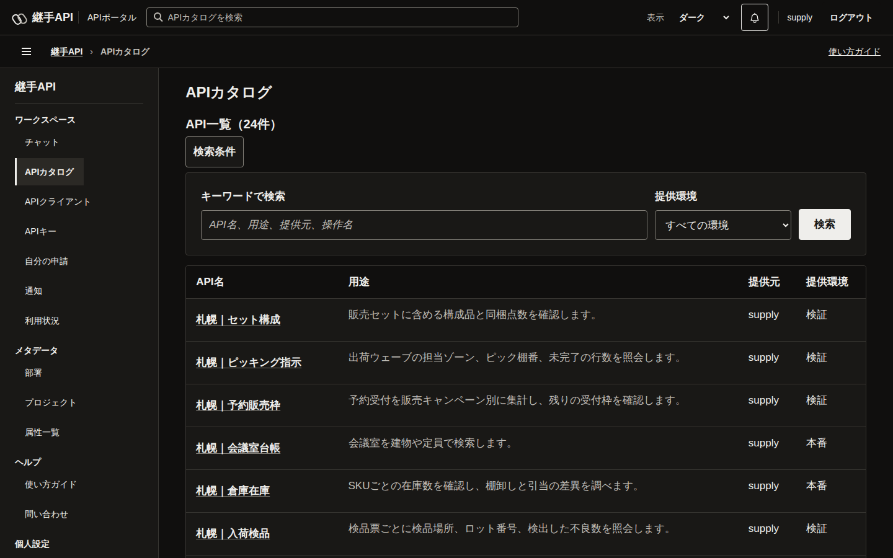

# 利用者は、ポータルの配色を選ぶとき、表示モードを変更できる

判定　合格

対象コミット　`413280ee0b9fbeb2f02c47a6a1a2080583707787`

[検証した要件と変更履歴](https://github.com/tsuji-tomonori/tsugite-api/blob/413280ee0b9fbeb2f02c47a6a1a2080583707787/docs/requirements/items/%E5%88%A9%E7%94%A8%E8%80%85%E3%81%AF%E3%80%81%E3%83%9D%E3%83%BC%E3%82%BF%E3%83%AB%E3%81%AE%E9%85%8D%E8%89%B2%E3%82%92%E9%81%B8%E3%81%B6%E3%81%A8%E3%81%8D%E3%80%81%E8%A1%A8%E7%A4%BA%E3%83%A2%E3%83%BC%E3%83%89%E3%82%92%E5%A4%89%E6%9B%B4%E3%81%A7%E3%81%8D%E3%82%8B.md)

## 実行したテストと証跡

- 成功　11月の外観変更を反映した明暗テーマの文字コントラストとキーボード操作を確認する（7.753 秒）　`tests/e2e/browser/test_portal.py::test_console_visual_modes`
  - 

[テスト実行記録（JUnit XML）](%E5%88%A9%E7%94%A8%E8%80%85%E3%81%AF%E3%80%81%E3%83%9D%E3%83%BC%E3%82%BF%E3%83%AB%E3%81%AE%E9%85%8D%E8%89%B2%E3%82%92%E9%81%B8%E3%81%B6%E3%81%A8%E3%81%8D%E3%80%81%E8%A1%A8%E7%A4%BA%E3%83%A2%E3%83%BC%E3%83%89%E3%82%92%E5%A4%89%E6%9B%B4%E3%81%A7%E3%81%8D%E3%82%8B.xml)
