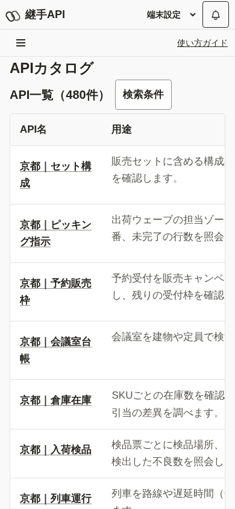

# 利用者は、ポータルを狭い画面で開いたとき、カタログを閲覧できる

判定　合格

対象コミット　`eb58d72252bc5cbfdc0c62506b047798636d428f`

[検証した要件と変更履歴](https://github.com/tsuji-tomonori/tsugite-api/blob/eb58d72252bc5cbfdc0c62506b047798636d428f/docs/requirements/items/%E5%88%A9%E7%94%A8%E8%80%85%E3%81%AF%E3%80%81%E3%83%9D%E3%83%BC%E3%82%BF%E3%83%AB%E3%82%92%E7%8B%AD%E3%81%84%E7%94%BB%E9%9D%A2%E3%81%A7%E9%96%8B%E3%81%84%E3%81%9F%E3%81%A8%E3%81%8D%E3%80%81%E3%82%AB%E3%82%BF%E3%83%AD%E3%82%B0%E3%82%92%E9%96%B2%E8%A6%A7%E3%81%A7%E3%81%8D%E3%82%8B.md)

## 実行したテストと証跡

- 成功　12業務・20拠点の公開240件を全件照合し、PC・スマートフォンの検索とページ送りを確認する（17.203 秒）　`tests/e2e/browser/test_portal.py::test_large_catalog`
  - 

[テスト実行記録（JUnit XML）](%E5%88%A9%E7%94%A8%E8%80%85%E3%81%AF%E3%80%81%E3%83%9D%E3%83%BC%E3%82%BF%E3%83%AB%E3%82%92%E7%8B%AD%E3%81%84%E7%94%BB%E9%9D%A2%E3%81%A7%E9%96%8B%E3%81%84%E3%81%9F%E3%81%A8%E3%81%8D%E3%80%81%E3%82%AB%E3%82%BF%E3%83%AD%E3%82%B0%E3%82%92%E9%96%B2%E8%A6%A7%E3%81%A7%E3%81%8D%E3%82%8B.xml)
