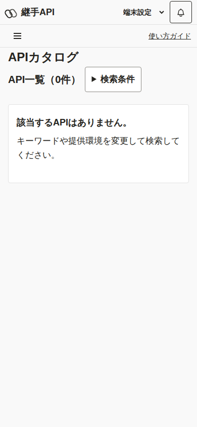

# 利用者は、ポータルを開いたとき、ポータルにログインできる

判定　合格

対象コミット　`fd4d5eb6fc4dd6e00ea5cd44a6a40c2fa7fc077a`

[検証した要件と変更履歴](https://github.com/tsuji-tomonori/tsugite-api/blob/fd4d5eb6fc4dd6e00ea5cd44a6a40c2fa7fc077a/docs/requirements/items/%E5%88%A9%E7%94%A8%E8%80%85%E3%81%AF%E3%80%81%E3%83%9D%E3%83%BC%E3%82%BF%E3%83%AB%E3%82%92%E9%96%8B%E3%81%84%E3%81%9F%E3%81%A8%E3%81%8D%E3%80%81%E3%83%9D%E3%83%BC%E3%82%BF%E3%83%AB%E3%81%AB%E3%83%AD%E3%82%B0%E3%82%A4%E3%83%B3%E3%81%A7%E3%81%8D%E3%82%8B.md)

## 実行したテストと証跡

- 成功　スマートフォンでログインし、確認コードを入力して元のカタログへ戻れる。（4.561 秒）　`tests/e2e/browser/test_portal.py::test_portal_login_on_mobile`
  - 
- 成功　初回パスワードの変更から認証アプリ登録まで、各応答のセッションを次の処理に渡す。（0.003 秒）　`packages/frontend/tests/test_portal_login.py::test_invitation_and_totp_setup`
- 成功　ログインの各段階で必要な入力を日本語ラベルと自動入力の用途で示す。（ログインには利用者名と現在のパスワードを入力する。）（0.003 秒）　`packages/frontend/tests/test_required_guide_home.py::test_login_forms_explain_the_current_step[signin]`
- 成功　ログインの各段階で必要な入力を日本語ラベルと自動入力の用途で示す。（招待直後は新しいパスワードを確認用にも入力する。）（0.002 秒）　`packages/frontend/tests/test_required_guide_home.py::test_login_forms_explain_the_current_step[new-password]`
- 成功　ログインの各段階で必要な入力を日本語ラベルと自動入力の用途で示す。（再設定の開始画面では利用者名を入力して確認コードを送る。）（0.002 秒）　`packages/frontend/tests/test_required_guide_home.py::test_login_forms_explain_the_current_step[forgot]`
- 成功　ログインの各段階で必要な入力を日本語ラベルと自動入力の用途で示す。（再設定には届いたコードと新しいパスワードを指定する。）（0.003 秒）　`packages/frontend/tests/test_required_guide_home.py::test_login_forms_explain_the_current_step[reset]`
- 成功　ログインの各段階で必要な入力を日本語ラベルと自動入力の用途で示す。（認証アプリの登録は確認コードを入力して確定する。）（0.002 秒）　`packages/frontend/tests/test_required_guide_home.py::test_login_forms_explain_the_current_step[totp-setup]`
- 成功　ログインの各段階で必要な入力を日本語ラベルと自動入力の用途で示す。（二要素認証ではアプリのコードを入力してログインする。）（0.003 秒）　`packages/frontend/tests/test_required_guide_home.py::test_login_forms_explain_the_current_step[totp-verification]`

[テスト実行記録（JUnit XML）](%E5%88%A9%E7%94%A8%E8%80%85%E3%81%AF%E3%80%81%E3%83%9D%E3%83%BC%E3%82%BF%E3%83%AB%E3%82%92%E9%96%8B%E3%81%84%E3%81%9F%E3%81%A8%E3%81%8D%E3%80%81%E3%83%9D%E3%83%BC%E3%82%BF%E3%83%AB%E3%81%AB%E3%83%AD%E3%82%B0%E3%82%A4%E3%83%B3%E3%81%A7%E3%81%8D%E3%82%8B.xml)
