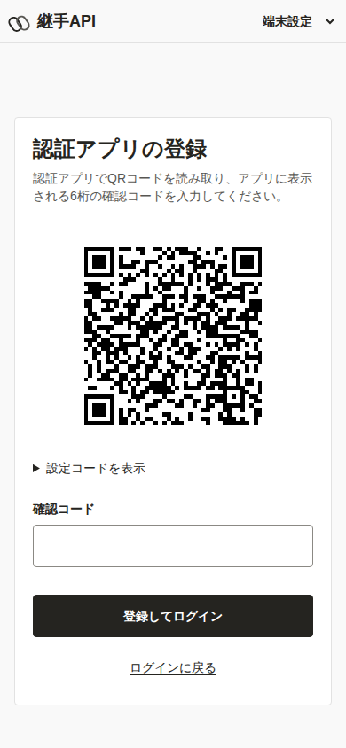

# 利用者は、初回ログインのとき、QRコードで認証アプリを登録できる

判定　合格

対象コミット　`d9f31e9b0159ab947c37778704413fe3714d504a`

[検証した要件と変更履歴](https://github.com/tsuji-tomonori/tsugite-api/blob/d9f31e9b0159ab947c37778704413fe3714d504a/docs/requirements/items/%E5%88%A9%E7%94%A8%E8%80%85%E3%81%AF%E3%80%81%E5%88%9D%E5%9B%9E%E3%83%AD%E3%82%B0%E3%82%A4%E3%83%B3%E3%81%AE%E3%81%A8%E3%81%8D%E3%80%81QR%E3%82%B3%E3%83%BC%E3%83%89%E3%81%A7%E8%AA%8D%E8%A8%BC%E3%82%A2%E3%83%97%E3%83%AA%E3%82%92%E7%99%BB%E9%8C%B2%E3%81%A7%E3%81%8D%E3%82%8B.md)

## 実行したテストと証跡

- 成功　登録用QRを先に表示し、設定コードを開いてコピー・再収納してから登録できる。（6.465 秒）　`tests/e2e/browser/test_portal.py::test_mfa_registration_codes`
  - 
- 成功　認証アプリに渡す利用者名・発行元・設定コードが一致し、手入力欄は閉じている。（0.011 秒）　`packages/frontend/tests/test_required_guide_home.py::test_registration_qr_matches_manual_code`

[テスト実行記録（JUnit XML）](%E5%88%A9%E7%94%A8%E8%80%85%E3%81%AF%E3%80%81%E5%88%9D%E5%9B%9E%E3%83%AD%E3%82%B0%E3%82%A4%E3%83%B3%E3%81%AE%E3%81%A8%E3%81%8D%E3%80%81QR%E3%82%B3%E3%83%BC%E3%83%89%E3%81%A7%E8%AA%8D%E8%A8%BC%E3%82%A2%E3%83%97%E3%83%AA%E3%82%92%E7%99%BB%E9%8C%B2%E3%81%A7%E3%81%8D%E3%82%8B.xml)
