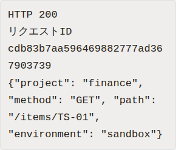

# 利用者は、利用権が有効なとき、APIを呼び出すことができる

判定　合格

対象コミット　`9a2088d8c854dae9b01bb1e76dc4a8081b914924`

## 実行したテストと証跡

- 成功　デモの提供者と利用者が公開・申請・承認・実行・権限取消を画面で完了できる（12.330 秒）　`tests/e2e/browser/test_portal.py::test_user_flow`
  - 
- 成功　承認した呼び出しを接続先へ転送し、権限取消後は遮断する（検証環境の在庫を照会する）（2.414 秒）　`tests/e2e/aws/test_portal.py::test_approved_calls_reach_upstream[cognito-lambda-staging]`
- 成功　承認した呼び出しを接続先へ転送し、権限取消後は遮断する（本番環境の在庫を照会する）（2.305 秒）　`tests/e2e/aws/test_portal.py::test_approved_calls_reach_upstream[cognito-lambda-production]`
- 成功　承認した呼び出しを接続先へ転送し、権限取消後は遮断する（利用者がLambdaへ接続する）（2.114 秒）　`tests/e2e/aws/test_portal.py::test_approved_calls_reach_upstream[cognito-lambda]`
- 成功　承認した呼び出しを接続先へ転送し、権限取消後は遮断する（システムがLambdaへ接続する）（2.103 秒）　`tests/e2e/aws/test_portal.py::test_approved_calls_reach_upstream[machine-lambda]`
- 成功　承認した呼び出しを接続先へ転送し、権限取消後は遮断する（利用者がHTTPS先へ接続する）（2.589 秒）　`tests/e2e/aws/test_portal.py::test_approved_calls_reach_upstream[cognito-https]`

[テスト実行記録（JUnit XML）](%E5%88%A9%E7%94%A8%E8%80%85%E3%81%AF%E3%80%81%E5%88%A9%E7%94%A8%E6%A8%A9%E3%81%8C%E6%9C%89%E5%8A%B9%E3%81%AA%E3%81%A8%E3%81%8D%E3%80%81API%E3%82%92%E5%91%BC%E3%81%B3%E5%87%BA%E3%81%99%E3%81%93%E3%81%A8%E3%81%8C%E3%81%A7%E3%81%8D%E3%82%8B.xml)
