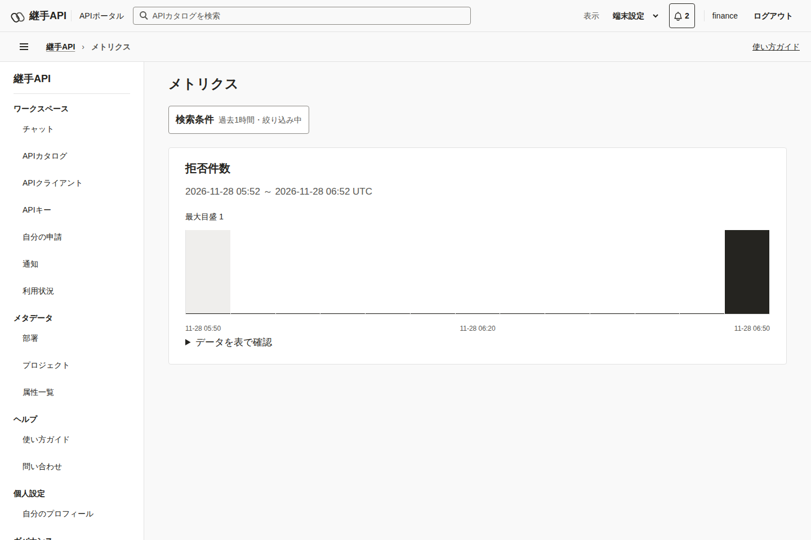

# 利用者は、利用状況を把握するとき、プロジェクト別の実績を確認できる

判定　合格

対象コミット　`e7d27c12156a070acf58bd298f088bc776c372dc`

[検証した要件と変更履歴](https://github.com/tsuji-tomonori/tsugite-api/blob/e7d27c12156a070acf58bd298f088bc776c372dc/docs/requirements/items/%E5%88%A9%E7%94%A8%E8%80%85%E3%81%AF%E3%80%81%E5%88%A9%E7%94%A8%E7%8A%B6%E6%B3%81%E3%82%92%E6%8A%8A%E6%8F%A1%E3%81%99%E3%82%8B%E3%81%A8%E3%81%8D%E3%80%81%E3%83%97%E3%83%AD%E3%82%B8%E3%82%A7%E3%82%AF%E3%83%88%E5%88%A5%E3%81%AE%E5%AE%9F%E7%B8%BE%E3%82%92%E7%A2%BA%E8%AA%8D%E3%81%A7%E3%81%8D%E3%82%8B.md)

## 実行したテストと証跡

- 成功　3役で利用状況、ユーザー管理、名称で選んだ宛先への通知、ログ保存、掲載終了を確認する。（13.540 秒）　`tests/e2e/browser/test_portal.py::test_governance_console`
  - 
- 成功　メトリクス取得が失敗しても件数とログを表示し、再読み込みで業務メニューのない利用状況が表示される。（0.034 秒）　`packages/frontend/tests/test_dashboard.py::test_dashboard_recovers_from_metrics_failure`

[テスト実行記録（JUnit XML）](%E5%88%A9%E7%94%A8%E8%80%85%E3%81%AF%E3%80%81%E5%88%A9%E7%94%A8%E7%8A%B6%E6%B3%81%E3%82%92%E6%8A%8A%E6%8F%A1%E3%81%99%E3%82%8B%E3%81%A8%E3%81%8D%E3%80%81%E3%83%97%E3%83%AD%E3%82%B8%E3%82%A7%E3%82%AF%E3%83%88%E5%88%A5%E3%81%AE%E5%AE%9F%E7%B8%BE%E3%82%92%E7%A2%BA%E8%AA%8D%E3%81%A7%E3%81%8D%E3%82%8B.xml)
