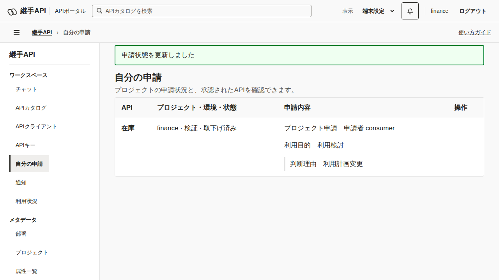

# 利用者は、利用申請が承認待ちのとき、利用申請を取り下げることができる

判定　合格

対象コミット　`15609cdd6e473e51afde3c0c502761ffab0f1acb`

[検証した要件と変更履歴](https://github.com/tsuji-tomonori/tsugite-api/blob/15609cdd6e473e51afde3c0c502761ffab0f1acb/docs/requirements/items/%E5%88%A9%E7%94%A8%E8%80%85%E3%81%AF%E3%80%81%E5%88%A9%E7%94%A8%E7%94%B3%E8%AB%8B%E3%81%8C%E6%89%BF%E8%AA%8D%E5%BE%85%E3%81%A1%E3%81%AE%E3%81%A8%E3%81%8D%E3%80%81%E5%88%A9%E7%94%A8%E7%94%B3%E8%AB%8B%E3%82%92%E5%8F%96%E3%82%8A%E4%B8%8B%E3%81%92%E3%82%8B%E3%81%93%E3%81%A8%E3%81%8C%E3%81%A7%E3%81%8D%E3%82%8B.md)

## 実行したテストと証跡

- 成功　利用者が承認待ちの申請を取り下げると画面に反映され、同じ環境に再申請できる。（6.014 秒）　`tests/e2e/browser/test_requirement_flows.py::test_withdraw_pending`
  - 

[テスト実行記録（JUnit XML）](%E5%88%A9%E7%94%A8%E8%80%85%E3%81%AF%E3%80%81%E5%88%A9%E7%94%A8%E7%94%B3%E8%AB%8B%E3%81%8C%E6%89%BF%E8%AA%8D%E5%BE%85%E3%81%A1%E3%81%AE%E3%81%A8%E3%81%8D%E3%80%81%E5%88%A9%E7%94%A8%E7%94%B3%E8%AB%8B%E3%82%92%E5%8F%96%E3%82%8A%E4%B8%8B%E3%81%92%E3%82%8B%E3%81%93%E3%81%A8%E3%81%8C%E3%81%A7%E3%81%8D%E3%82%8B.xml)
