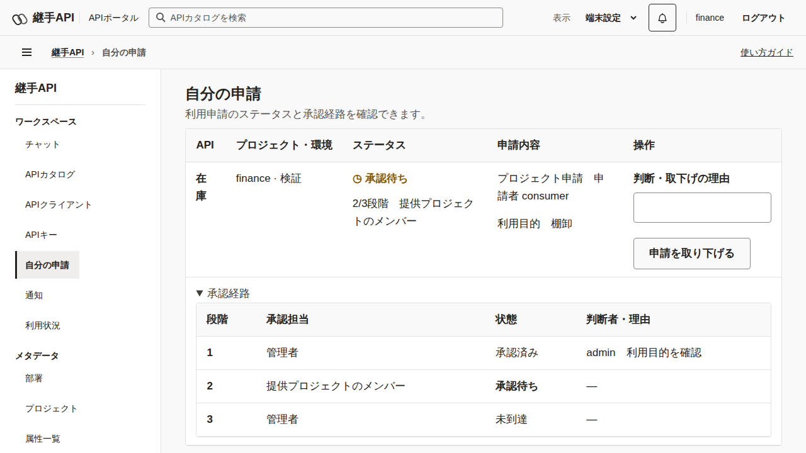

# 利用者は、利用申請を提出したとき、承認の進捗を確認できる

判定　合格

対象コミット　`6ea13b6727fccc012bd33ea31a29b99858f4967b`

[検証した要件と変更履歴](https://github.com/tsuji-tomonori/tsugite-api/blob/6ea13b6727fccc012bd33ea31a29b99858f4967b/docs/requirements/items/%E5%88%A9%E7%94%A8%E8%80%85%E3%81%AF%E3%80%81%E5%88%A9%E7%94%A8%E7%94%B3%E8%AB%8B%E3%82%92%E6%8F%90%E5%87%BA%E3%81%97%E3%81%9F%E3%81%A8%E3%81%8D%E3%80%81%E6%89%BF%E8%AA%8D%E3%81%AE%E9%80%B2%E6%8D%97%E3%82%92%E7%A2%BA%E8%AA%8D%E3%81%A7%E3%81%8D%E3%82%8B.md)

## 実行したテストと証跡

- 成功　同じ担当を含む経路の現在地、各段階の判断と申請の終了を区別できる。（0.011 秒）　`packages/frontend/tests/test_required_product_views.py::test_applicant_sees_request_progress`
- 成功　申請者が自分の一覧から中間承認後の現在地と残りの担当を確認できる。（7.499 秒）　`tests/e2e/browser/test_requirement_flows.py::test_applicant_tracks_review`
  - 

[テスト実行記録（JUnit XML）](%E5%88%A9%E7%94%A8%E8%80%85%E3%81%AF%E3%80%81%E5%88%A9%E7%94%A8%E7%94%B3%E8%AB%8B%E3%82%92%E6%8F%90%E5%87%BA%E3%81%97%E3%81%9F%E3%81%A8%E3%81%8D%E3%80%81%E6%89%BF%E8%AA%8D%E3%81%AE%E9%80%B2%E6%8D%97%E3%82%92%E7%A2%BA%E8%AA%8D%E3%81%A7%E3%81%8D%E3%82%8B.xml)
