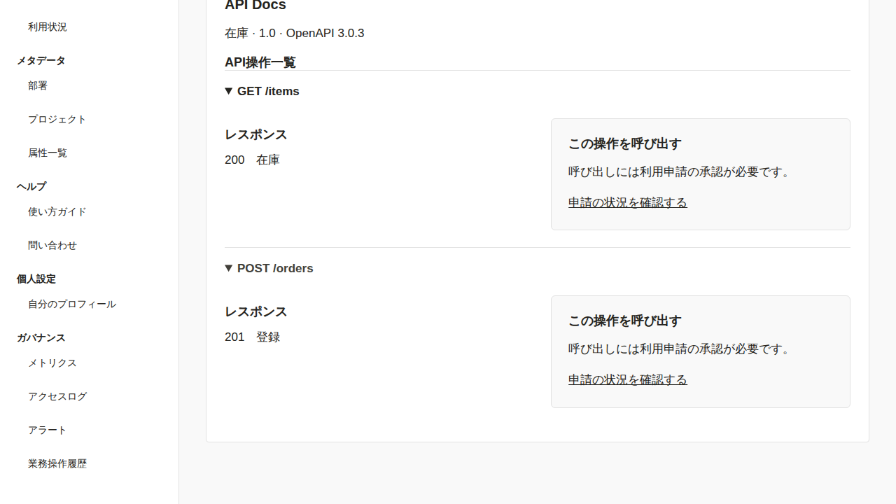

# 利用者は、商品の仕様を調べるとき、API操作を一覧で確認できる

判定　合格

対象コミット　`a8ce7bc1f7c63cce6c1b5f352626ae1b791f7a85`

## 実行したテストと証跡

- 成功　商品を公開し、利用者が商品詳細から利用申請できる（11.619 秒）　`tests/e2e/browser/test_product_publication.py::test_publish_and_apply_from_product_page`
  - 

[テスト実行記録（JUnit XML）](%E5%88%A9%E7%94%A8%E8%80%85%E3%81%AF%E3%80%81%E5%95%86%E5%93%81%E3%81%AE%E4%BB%95%E6%A7%98%E3%82%92%E8%AA%BF%E3%81%B9%E3%82%8B%E3%81%A8%E3%81%8D%E3%80%81API%E6%93%8D%E4%BD%9C%E3%82%92%E4%B8%80%E8%A6%A7%E3%81%A7%E7%A2%BA%E8%AA%8D%E3%81%A7%E3%81%8D%E3%82%8B.xml)
