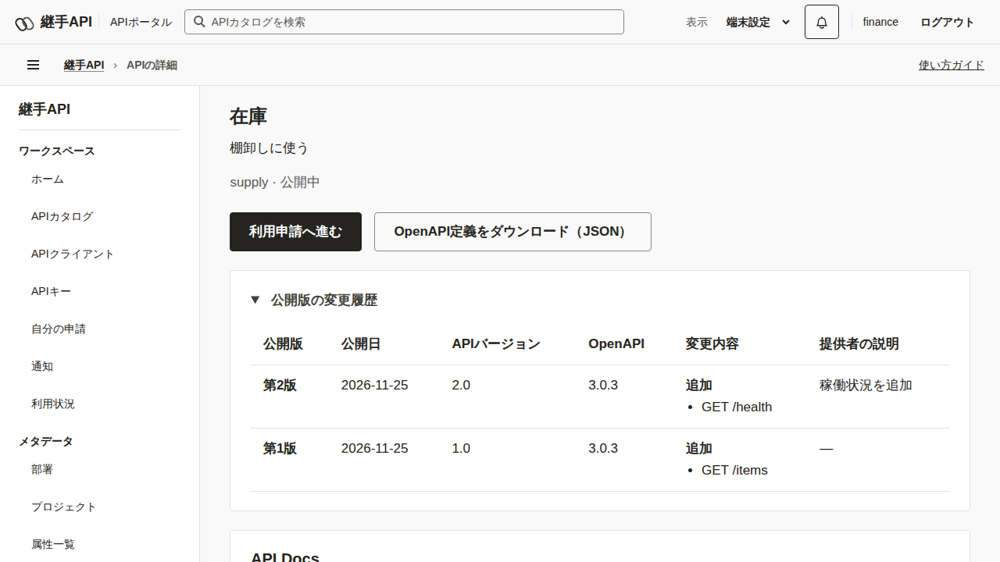

# 利用者は、商品の版が変わったとき、公開版の変更履歴を確認できる

判定　合格

対象コミット　`01130309252051badc6cb01f91b2a33a407ed01c`

## 実行したテストと証跡

- 成功　利用者が商品画面で旧版と新版の版番号、追加された操作と提供者の説明を確認できる。（6.158 秒）　`tests/e2e/browser/test_requirement_flows.py::test_release_history`
  - 
- 成功　公開時にOpenAPI仕様の世代をS3に個別保存する（0.244 秒）　`tests/e2e/aws/test_resources.py::test_openapi_archive_versions`

[テスト実行記録（JUnit XML）](%E5%88%A9%E7%94%A8%E8%80%85%E3%81%AF%E3%80%81%E5%95%86%E5%93%81%E3%81%AE%E7%89%88%E3%81%8C%E5%A4%89%E3%82%8F%E3%81%A3%E3%81%9F%E3%81%A8%E3%81%8D%E3%80%81%E5%85%AC%E9%96%8B%E7%89%88%E3%81%AE%E5%A4%89%E6%9B%B4%E5%B1%A5%E6%AD%B4%E3%82%92%E7%A2%BA%E8%AA%8D%E3%81%A7%E3%81%8D%E3%82%8B.xml)
