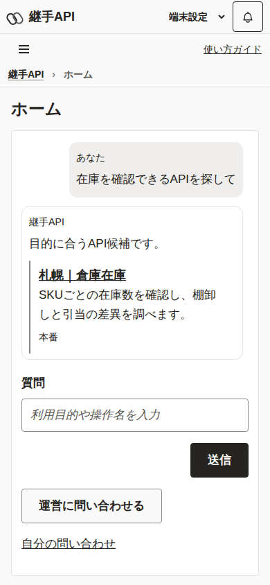

# 利用者は、商品を日本語で探すとき、チャットで候補を確認できる

判定　合格

対象コミット　`01130309252051badc6cb01f91b2a33a407ed01c`

## 実行したテストと証跡

- 成功　ホームで商品と手順を調べ、運営への問い合わせを明示的に送信できる。（7.073 秒）　`tests/e2e/browser/test_portal.py::test_home_chat_and_inquiry`
  - 
- 成功　語句が一致しない質問も日本語埋め込みで公開商品に結び付ける。（0.004 秒）　`packages/agent/tests/test_agent_retrieval.py::test_model_resolves_paraphrase_with_hybrid_retrieval`

[テスト実行記録（JUnit XML）](%E5%88%A9%E7%94%A8%E8%80%85%E3%81%AF%E3%80%81%E5%95%86%E5%93%81%E3%82%92%E6%97%A5%E6%9C%AC%E8%AA%9E%E3%81%A7%E6%8E%A2%E3%81%99%E3%81%A8%E3%81%8D%E3%80%81%E3%83%81%E3%83%A3%E3%83%83%E3%83%88%E3%81%A7%E5%80%99%E8%A3%9C%E3%82%92%E7%A2%BA%E8%AA%8D%E3%81%A7%E3%81%8D%E3%82%8B.xml)
