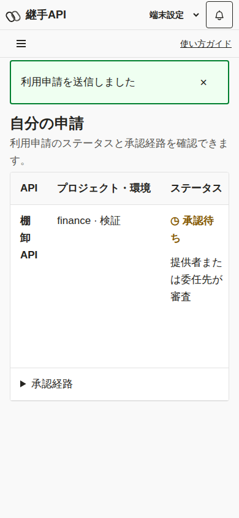

# 利用者は、商品を業務で使うとき、利用申請を提出できる

判定　合格

対象コミット　`a8ce7bc1f7c63cce6c1b5f352626ae1b791f7a85`

## 実行したテストと証跡

- 成功　デモの提供者と利用者が公開・申請・承認・実行・権限取消を画面で完了できる（13.552 秒）　`tests/e2e/browser/test_portal.py::test_user_flow`
  - 

[テスト実行記録（JUnit XML）](%E5%88%A9%E7%94%A8%E8%80%85%E3%81%AF%E3%80%81%E5%95%86%E5%93%81%E3%82%92%E6%A5%AD%E5%8B%99%E3%81%A7%E4%BD%BF%E3%81%86%E3%81%A8%E3%81%8D%E3%80%81%E5%88%A9%E7%94%A8%E7%94%B3%E8%AB%8B%E3%82%92%E6%8F%90%E5%87%BA%E3%81%A7%E3%81%8D%E3%82%8B.xml)
