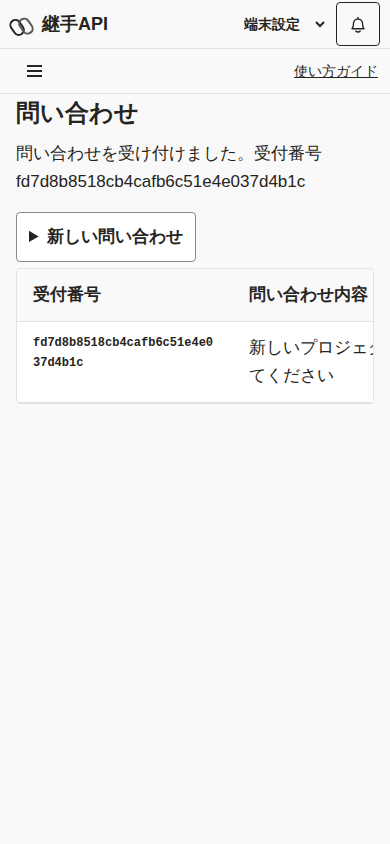

# 利用者は、問い合わせ画面を開いたとき、問い合わせを送信できる

判定　合格

対象コミット　`44976472fbf53461052e4e879e7f140efc8ae599`

[検証した要件と変更履歴](https://github.com/tsuji-tomonori/tsugite-api/blob/44976472fbf53461052e4e879e7f140efc8ae599/docs/requirements/items/%E5%88%A9%E7%94%A8%E8%80%85%E3%81%AF%E3%80%81%E5%95%8F%E3%81%84%E5%90%88%E3%82%8F%E3%81%9B%E7%94%BB%E9%9D%A2%E3%82%92%E9%96%8B%E3%81%84%E3%81%9F%E3%81%A8%E3%81%8D%E3%80%81%E5%95%8F%E3%81%84%E5%90%88%E3%82%8F%E3%81%9B%E3%82%92%E9%80%81%E4%BF%A1%E3%81%A7%E3%81%8D%E3%82%8B.md)

## 実行したテストと証跡

- 成功　利用者が問い合わせ画面から送信すると受付番号が表示され、再訪しても回答待ちの履歴を確認できる。（8.369 秒）　`tests/e2e/browser/test_portal.py::test_submit_from_inquiries`
  - 
- 成功　応答を受け取れずに再送しても受付番号を再利用し、次の新規送信には別の番号を使う。（0.004 秒）　`packages/frontend/tests/test_inquiry_form.py::test_retry_reuses_pending_inquiry_id`

[テスト実行記録（JUnit XML）](%E5%88%A9%E7%94%A8%E8%80%85%E3%81%AF%E3%80%81%E5%95%8F%E3%81%84%E5%90%88%E3%82%8F%E3%81%9B%E7%94%BB%E9%9D%A2%E3%82%92%E9%96%8B%E3%81%84%E3%81%9F%E3%81%A8%E3%81%8D%E3%80%81%E5%95%8F%E3%81%84%E5%90%88%E3%82%8F%E3%81%9B%E3%82%92%E9%80%81%E4%BF%A1%E3%81%A7%E3%81%8D%E3%82%8B.xml)
