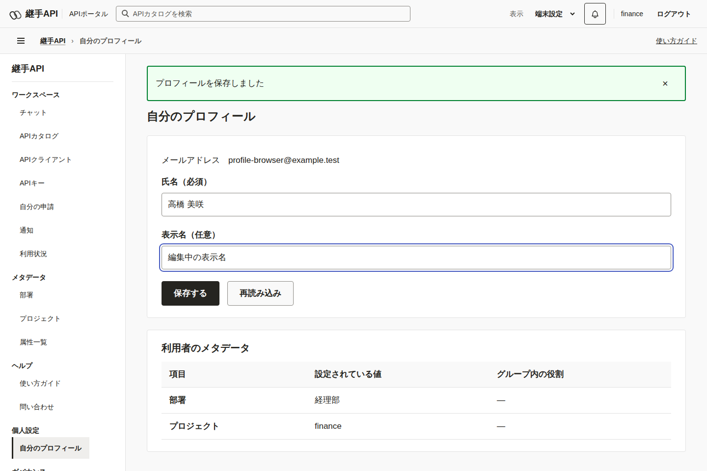

# 利用者は、操作結果バナーを確認したとき、操作結果バナーを閉じることができる

判定　合格

対象コミット　`fdbcbaadb8ae5edfd98cc4f9d30923b3da6fb8d3`

[検証した要件と変更履歴](https://github.com/tsuji-tomonori/tsugite-api/blob/fdbcbaadb8ae5edfd98cc4f9d30923b3da6fb8d3/docs/requirements/items/%E5%88%A9%E7%94%A8%E8%80%85%E3%81%AF%E3%80%81%E6%93%8D%E4%BD%9C%E7%B5%90%E6%9E%9C%E3%83%90%E3%83%8A%E3%83%BC%E3%82%92%E7%A2%BA%E8%AA%8D%E3%81%97%E3%81%9F%E3%81%A8%E3%81%8D%E3%80%81%E6%93%8D%E4%BD%9C%E7%B5%90%E6%9E%9C%E3%83%90%E3%83%8A%E3%83%BC%E3%82%92%E9%96%89%E3%81%98%E3%82%8B%E3%81%93%E3%81%A8%E3%81%8C%E3%81%A7%E3%81%8D%E3%82%8B.md)

## 実行したテストと証跡

- 成功　全画面の閉じるボタンで現在の通知が消え、次の通知を表示できる。（ログイン前の完了通知を閉じる。）（0.007 秒）　`packages/frontend/tests/test_required_guide_navigation.py::test_dismiss_current_notice[login-success]`
- 成功　全画面の閉じるボタンで現在の通知が消え、次の通知を表示できる。（ログイン前のエラーを閉じる。）（0.007 秒）　`packages/frontend/tests/test_required_guide_navigation.py::test_dismiss_current_notice[login-error]`
- 成功　全画面の閉じるボタンで現在の通知が消え、次の通知を表示できる。（ログイン後の完了通知を閉じる。）（0.036 秒）　`packages/frontend/tests/test_required_guide_navigation.py::test_dismiss_current_notice[portal-success]`
- 成功　全画面の閉じるボタンで現在の通知が消え、次の通知を表示できる。（ログイン後のエラーを閉じる。）（0.033 秒）　`packages/frontend/tests/test_required_guide_navigation.py::test_dismiss_current_notice[portal-error]`
- 成功　管理者が招待時に氏名を入力し、本人の表示名とともに兼務先に表示して監査を確認する。（7.766 秒）　`tests/e2e/browser/test_member_profile_console.py::test_member_profile_management`
  - 

[テスト実行記録（JUnit XML）](%E5%88%A9%E7%94%A8%E8%80%85%E3%81%AF%E3%80%81%E6%93%8D%E4%BD%9C%E7%B5%90%E6%9E%9C%E3%83%90%E3%83%8A%E3%83%BC%E3%82%92%E7%A2%BA%E8%AA%8D%E3%81%97%E3%81%9F%E3%81%A8%E3%81%8D%E3%80%81%E6%93%8D%E4%BD%9C%E7%B5%90%E6%9E%9C%E3%83%90%E3%83%8A%E3%83%BC%E3%82%92%E9%96%89%E3%81%98%E3%82%8B%E3%81%93%E3%81%A8%E3%81%8C%E3%81%A7%E3%81%8D%E3%82%8B.xml)
