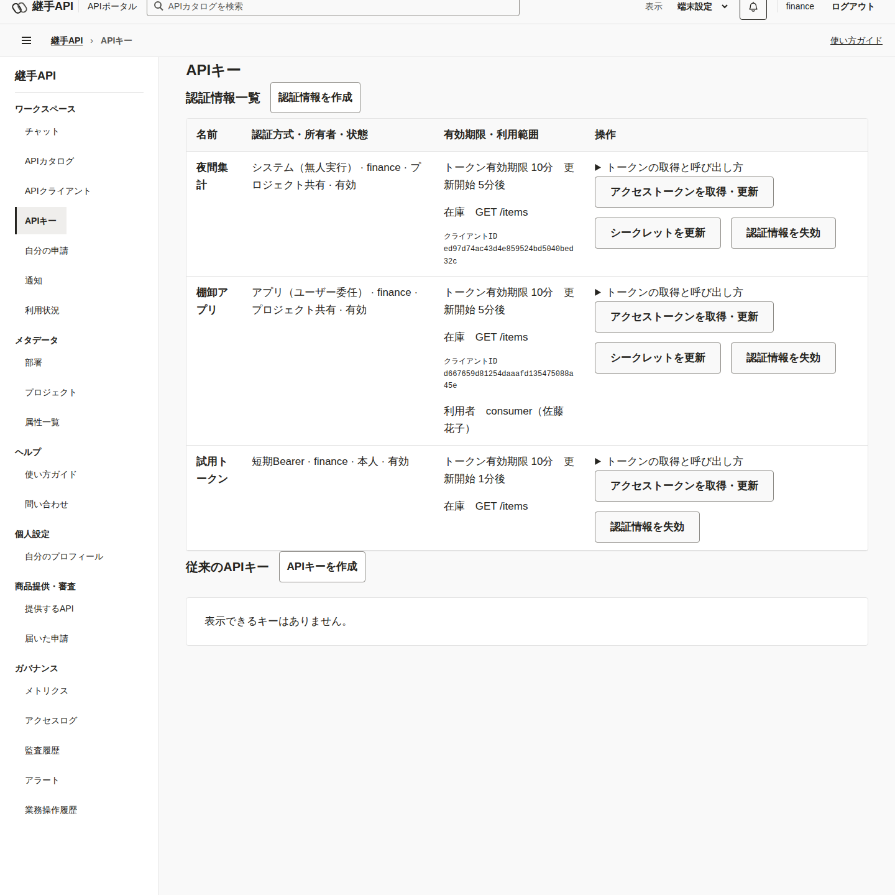

# 利用者は、本人の利用権でアプリを動かすとき、アプリ認証を発行できる

判定　合格

対象コミット　`e7804a0c129717485df3c009b4b6cd620cf393a7`

[検証した要件と変更履歴](https://github.com/tsuji-tomonori/tsugite-api/blob/e7804a0c129717485df3c009b4b6cd620cf393a7/docs/requirements/items/%E5%88%A9%E7%94%A8%E8%80%85%E3%81%AF%E3%80%81%E6%9C%AC%E4%BA%BA%E3%81%AE%E5%88%A9%E7%94%A8%E6%A8%A9%E3%81%A7%E3%82%A2%E3%83%97%E3%83%AA%E3%82%92%E5%8B%95%E3%81%8B%E3%81%99%E3%81%A8%E3%81%8D%E3%80%81%E3%82%A2%E3%83%97%E3%83%AA%E8%AA%8D%E8%A8%BC%E3%82%92%E7%99%BA%E8%A1%8C%E3%81%A7%E3%81%8D%E3%82%8B.md)

## 実行したテストと証跡

- 成功　ブラウザーで3方式を発行し、実時計で1分後に更新、シークレット変更・失効まで確認する（65.787 秒）　`tests/e2e/browser/test_credentials_console.py::test_credentials_console`
  - 
- 成功　AWS EmulatorのCognito利用者とシステムのトークンを発行し、HTTPS到達・拒否・秘密更新を確認する（7.129 秒）　`tests/e2e/aws/test_credential_tokens.py::test_client_tokens_reach_https`
- 成功　アプリ・システムの交換条件を照合し、失効したシークレットや本人資格の過不足を拒否する。（形式仕様の操作と期待状態を照合する。）（0.122 秒）　`packages/backend/tests/test_quint_grants.py::test_exchange_contract[exchange.exchangeTest]`
- 成功　認証方式に応じた手順で期限付きトークンを発行し、利用後は対象の認証情報だけを失効させる。（本人の短期Bearerで承認済みAPI全体を呼べる）（0.184 秒）　`packages/backend/tests/test_required_credentials.py::test_issue_use_and_retire_credentials[bearer-all]`
- 成功　認証方式に応じた手順で期限付きトークンを発行し、利用後は対象の認証情報だけを失効させる。（共有の短期Bearerを指定のAPIで利用できる）（0.464 秒）　`packages/backend/tests/test_required_credentials.py::test_issue_use_and_retire_credentials[bearer-project]`
- 成功　認証方式に応じた手順で期限付きトークンを発行し、利用後は対象の認証情報だけを失効させる。（アプリと本人の資格で指定のAPIを利用できる）（0.203 秒）　`packages/backend/tests/test_required_credentials.py::test_issue_use_and_retire_credentials[app-personal]`
- 成功　認証方式に応じた手順で期限付きトークンを発行し、利用後は対象の認証情報だけを失効させる。（共有アプリで指定したメンバーが承認済み操作を利用できる）（0.202 秒）　`packages/backend/tests/test_required_credentials.py::test_issue_use_and_retire_credentials[app-for-members]`
- 成功　認証方式に応じた手順で期限付きトークンを発行し、利用後は対象の認証情報だけを失効させる。（プロジェクトのリーダーがシステム認証を発行し、利用者のログインなしで交換できる）（0.193 秒）　`packages/backend/tests/test_required_credentials.py::test_issue_use_and_retire_credentials[system-project]`

[テスト実行記録（JUnit XML）](%E5%88%A9%E7%94%A8%E8%80%85%E3%81%AF%E3%80%81%E6%9C%AC%E4%BA%BA%E3%81%AE%E5%88%A9%E7%94%A8%E6%A8%A9%E3%81%A7%E3%82%A2%E3%83%97%E3%83%AA%E3%82%92%E5%8B%95%E3%81%8B%E3%81%99%E3%81%A8%E3%81%8D%E3%80%81%E3%82%A2%E3%83%97%E3%83%AA%E8%AA%8D%E8%A8%BC%E3%82%92%E7%99%BA%E8%A1%8C%E3%81%A7%E3%81%8D%E3%82%8B.xml)
