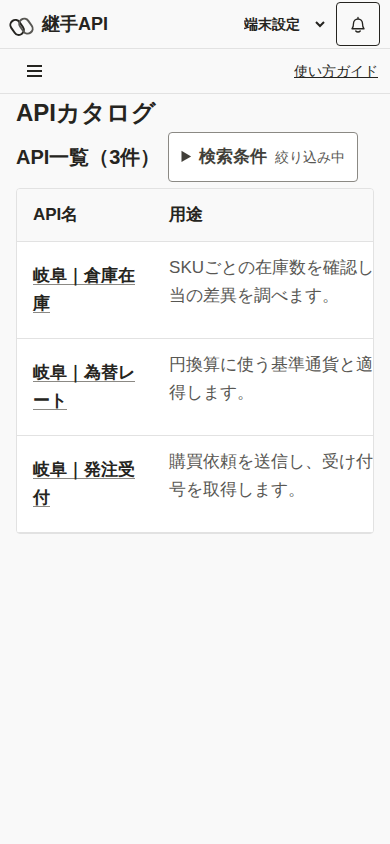

# 利用者は、用途に合う商品を探すとき、カタログを検索できる

判定　合格

対象コミット　`44976472fbf53461052e4e879e7f140efc8ae599`

[検証した要件と変更履歴](https://github.com/tsuji-tomonori/tsugite-api/blob/44976472fbf53461052e4e879e7f140efc8ae599/docs/requirements/items/%E5%88%A9%E7%94%A8%E8%80%85%E3%81%AF%E3%80%81%E7%94%A8%E9%80%94%E3%81%AB%E5%90%88%E3%81%86%E5%95%86%E5%93%81%E3%82%92%E6%8E%A2%E3%81%99%E3%81%A8%E3%81%8D%E3%80%81%E3%82%AB%E3%82%BF%E3%83%AD%E3%82%B0%E3%82%92%E6%A4%9C%E7%B4%A2%E3%81%A7%E3%81%8D%E3%82%8B.md)

## 実行したテストと証跡

- 成功　12業務・20拠点の公開240件を全件照合し、PC・スマートフォンの検索とページ送りを確認する（23.239 秒）　`tests/e2e/browser/test_portal.py::test_large_catalog`
  - 

[テスト実行記録（JUnit XML）](%E5%88%A9%E7%94%A8%E8%80%85%E3%81%AF%E3%80%81%E7%94%A8%E9%80%94%E3%81%AB%E5%90%88%E3%81%86%E5%95%86%E5%93%81%E3%82%92%E6%8E%A2%E3%81%99%E3%81%A8%E3%81%8D%E3%80%81%E3%82%AB%E3%82%BF%E3%83%AD%E3%82%B0%E3%82%92%E6%A4%9C%E7%B4%A2%E3%81%A7%E3%81%8D%E3%82%8B.xml)
