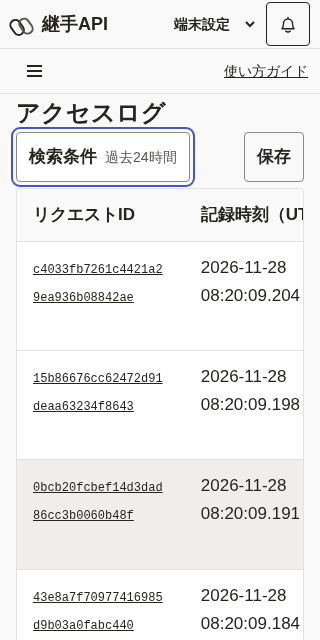

# 利用者は、自分のAPI呼び出しを調べるとき、本人のアクセスログを確認できる

判定　合格

対象コミット　`fd4d5eb6fc4dd6e00ea5cd44a6a40c2fa7fc077a`

[検証した要件と変更履歴](https://github.com/tsuji-tomonori/tsugite-api/blob/fd4d5eb6fc4dd6e00ea5cd44a6a40c2fa7fc077a/docs/requirements/items/%E5%88%A9%E7%94%A8%E8%80%85%E3%81%AF%E3%80%81%E8%87%AA%E5%88%86%E3%81%AEAPI%E5%91%BC%E3%81%B3%E5%87%BA%E3%81%97%E3%82%92%E8%AA%BF%E3%81%B9%E3%82%8B%E3%81%A8%E3%81%8D%E3%80%81%E6%9C%AC%E4%BA%BA%E3%81%AE%E3%82%A2%E3%82%AF%E3%82%BB%E3%82%B9%E3%83%AD%E3%82%B0%E3%82%92%E7%A2%BA%E8%AA%8D%E3%81%A7%E3%81%8D%E3%82%8B.md)

## 実行したテストと証跡

- 成功　同じ所属でも本人の履歴を分離し、配下の監査・絞り込み・出力と権限解除を検証する。（1.340 秒）　`packages/backend/tests/test_org_access.py::test_access_log_scopes`
- 成功　利用者が2ページ目の1件を開き、同じリクエストIDで質問と問い合わせを送れる。（8.129 秒）　`tests/e2e/browser/test_requirement_flows.py::test_access_log_detail_and_support`
  - 
- 成功　監査の役割と呼出時の帰属に従い、本人画面と監査画面の詳細を照合する。（形式仕様の操作と期待状態を照合する。）（0.233 秒）　`packages/backend/tests/test_quint_governance.py::test_log_history[audit.auditLogTest]`
- 成功　監査の役割と呼出時の帰属に従い、本人画面と監査画面の詳細を照合する。（形式仕様の操作と期待状態を照合する。）（0.225 秒）　`packages/backend/tests/test_quint_governance.py::test_log_history[audit.personalLogTest]`

[テスト実行記録（JUnit XML）](%E5%88%A9%E7%94%A8%E8%80%85%E3%81%AF%E3%80%81%E8%87%AA%E5%88%86%E3%81%AEAPI%E5%91%BC%E3%81%B3%E5%87%BA%E3%81%97%E3%82%92%E8%AA%BF%E3%81%B9%E3%82%8B%E3%81%A8%E3%81%8D%E3%80%81%E6%9C%AC%E4%BA%BA%E3%81%AE%E3%82%A2%E3%82%AF%E3%82%BB%E3%82%B9%E3%83%AD%E3%82%B0%E3%82%92%E7%A2%BA%E8%AA%8D%E3%81%A7%E3%81%8D%E3%82%8B.xml)
