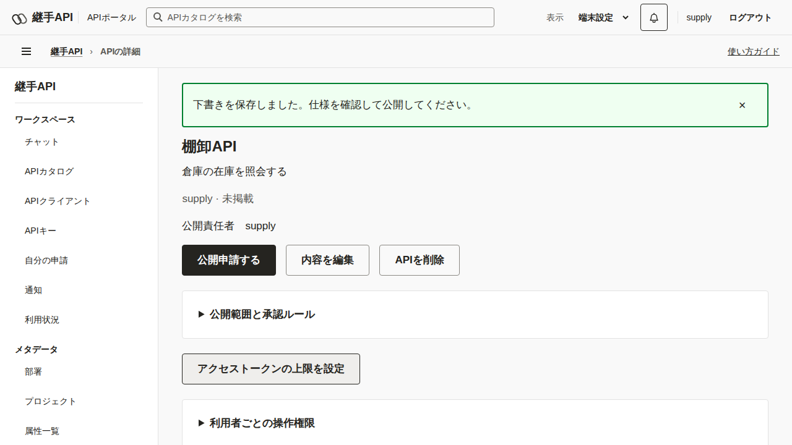

# 提供者は、APIを出品するとき、下書きを登録できる

判定　合格

対象コミット　`e7804a0c129717485df3c009b4b6cd620cf393a7`

[検証した要件と変更履歴](https://github.com/tsuji-tomonori/tsugite-api/blob/e7804a0c129717485df3c009b4b6cd620cf393a7/docs/requirements/items/%E6%8F%90%E4%BE%9B%E8%80%85%E3%81%AF%E3%80%81API%E3%82%92%E5%87%BA%E5%93%81%E3%81%99%E3%82%8B%E3%81%A8%E3%81%8D%E3%80%81%E4%B8%8B%E6%9B%B8%E3%81%8D%E3%82%92%E7%99%BB%E9%8C%B2%E3%81%A7%E3%81%8D%E3%82%8B.md)

## 実行したテストと証跡

- 成功　デモの提供者と利用者が公開・申請・承認・実行・権限取消を画面で完了できる（13.019 秒）　`tests/e2e/browser/test_portal.py::test_user_flow`
  - 
- 成功　接続確認の後、呼び出し情報をLambdaへ渡して応答を返す（0.000 秒）　`packages/backend/tests/test_integrations.py::test_lambda_adapter`
- 成功　クエリと認証情報を保持してHTTPSの接続先に転送する（0.001 秒）　`packages/backend/tests/test_integrations.py::test_https_adapter`
- 成功　接続確認の後、呼び出し情報をLambdaへ渡して応答を返す（0.000 秒）　`packages/backend/tests/test_integrations.py::test_lambda_adapter`
- 成功　クエリと認証情報を保持してHTTPSの接続先に転送する（0.001 秒）　`packages/backend/tests/test_integrations.py::test_https_adapter`
- 成功　名称変更では利用権を保持し、構造変更・削除では公開と既存の権利を終了する。（形式仕様の操作と期待状態を照合する。）（0.174 秒）　`packages/backend/tests/test_quint_grants.py::test_product_history[products.deleteTest]`
- 成功　名称変更では利用権を保持し、構造変更・削除では公開と既存の権利を終了する。（形式仕様の操作と期待状態を照合する。）（0.485 秒）　`packages/backend/tests/test_quint_grants.py::test_product_history[products.editTest]`
- 成功　名称変更では利用権を保持し、構造変更・削除では公開と既存の権利を終了する。（形式仕様の操作と期待状態を照合する。）（0.166 秒）　`packages/backend/tests/test_quint_grants.py::test_product_history[products.pendingEditTest]`

[テスト実行記録（JUnit XML）](%E6%8F%90%E4%BE%9B%E8%80%85%E3%81%AF%E3%80%81API%E3%82%92%E5%87%BA%E5%93%81%E3%81%99%E3%82%8B%E3%81%A8%E3%81%8D%E3%80%81%E4%B8%8B%E6%9B%B8%E3%81%8D%E3%82%92%E7%99%BB%E9%8C%B2%E3%81%A7%E3%81%8D%E3%82%8B.xml)
