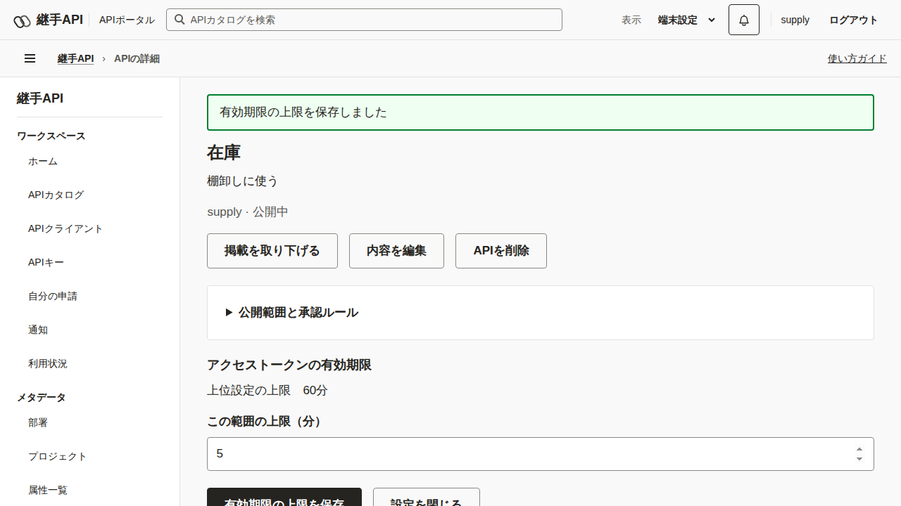

# 提供者は、アクセストークンの期限を制限するとき、有効期間を短縮できる

判定　合格

対象コミット　`15609cdd6e473e51afde3c0c502761ffab0f1acb`

[検証した要件と変更履歴](https://github.com/tsuji-tomonori/tsugite-api/blob/15609cdd6e473e51afde3c0c502761ffab0f1acb/docs/requirements/items/%E6%8F%90%E4%BE%9B%E8%80%85%E3%81%AF%E3%80%81%E3%82%A2%E3%82%AF%E3%82%BB%E3%82%B9%E3%83%88%E3%83%BC%E3%82%AF%E3%83%B3%E3%81%AE%E6%9C%9F%E9%99%90%E3%82%92%E5%88%B6%E9%99%90%E3%81%99%E3%82%8B%E3%81%A8%E3%81%8D%E3%80%81%E6%9C%89%E5%8A%B9%E6%9C%9F%E9%96%93%E3%82%92%E7%9F%AD%E7%B8%AE%E3%81%A7%E3%81%8D%E3%82%8B.md)

## 実行したテストと証跡

- 成功　提供者が商品ごとのトークンの上限を短縮すると、利用者による上限超過の発行を拒否する。（6.439 秒）　`tests/e2e/browser/test_requirement_flows.py::test_provider_shortens_token_lifetime`
  - 
- 成功　提供者・部署・プロジェクトの上限、更新と失効の秒境界、発行後の上限短縮を確認する（0.386 秒）　`packages/backend/tests/test_credential_lifecycle.py::test_nested_token_lifetime`

[テスト実行記録（JUnit XML）](%E6%8F%90%E4%BE%9B%E8%80%85%E3%81%AF%E3%80%81%E3%82%A2%E3%82%AF%E3%82%BB%E3%82%B9%E3%83%88%E3%83%BC%E3%82%AF%E3%83%B3%E3%81%AE%E6%9C%9F%E9%99%90%E3%82%92%E5%88%B6%E9%99%90%E3%81%99%E3%82%8B%E3%81%A8%E3%81%8D%E3%80%81%E6%9C%89%E5%8A%B9%E6%9C%9F%E9%96%93%E3%82%92%E7%9F%AD%E7%B8%AE%E3%81%A7%E3%81%8D%E3%82%8B.xml)
