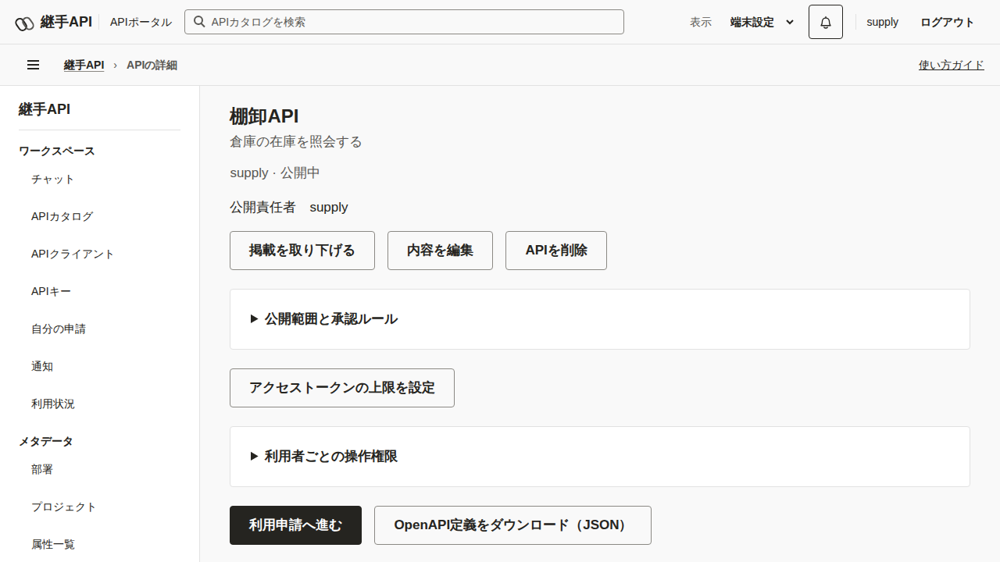

# 提供者は、下書きの接続を確認したとき、商品を公開できる

判定　合格

対象コミット　`6c5d9454a36539294e6e9e7375a4948a217118f5`

[検証した要件と変更履歴](https://github.com/tsuji-tomonori/tsugite-api/blob/6c5d9454a36539294e6e9e7375a4948a217118f5/docs/requirements/items/%E6%8F%90%E4%BE%9B%E8%80%85%E3%81%AF%E3%80%81%E4%B8%8B%E6%9B%B8%E3%81%8D%E3%81%AE%E6%8E%A5%E7%B6%9A%E3%82%92%E7%A2%BA%E8%AA%8D%E3%81%97%E3%81%9F%E3%81%A8%E3%81%8D%E3%80%81%E5%95%86%E5%93%81%E3%82%92%E5%85%AC%E9%96%8B%E3%81%A7%E3%81%8D%E3%82%8B.md)

## 実行したテストと証跡

- 成功　デモの提供者と利用者が公開・申請・承認・実行・権限取消を画面で完了できる（9.068 秒）　`tests/e2e/browser/test_portal.py::test_user_flow`
  - 
- 成功　接続確認に失敗したAPIは下書きのまま残る（0.139 秒）　`packages/backend/tests/test_integrations.py::test_failed_probe_keeps_draft`
- 成功　Cognitoで識別した2人が画面で承認し、在庫照会・取消・監査まで進める（8.850 秒）　`tests/e2e/aws/test_portal.py::test_cognito_browser`
  - 
- 成功　外部参照、環境違いの接続先、不正な仕様の登録を拒否する（0.567 秒）　`packages/backend/tests/test_catalog.py::test_registration_validation`
- 成功　名称変更では利用権を保持し、構造変更・削除では公開と既存の権利を終了する。（形式仕様の操作と期待状態を照合する。）（0.178 秒）　`packages/backend/tests/test_quint_grants.py::test_product_history[products.deleteTest]`
- 成功　名称変更では利用権を保持し、構造変更・削除では公開と既存の権利を終了する。（形式仕様の操作と期待状態を照合する。）（0.175 秒）　`packages/backend/tests/test_quint_grants.py::test_product_history[products.editTest]`
- 成功　名称変更では利用権を保持し、構造変更・削除では公開と既存の権利を終了する。（形式仕様の操作と期待状態を照合する。）（0.172 秒）　`packages/backend/tests/test_quint_grants.py::test_product_history[products.pendingEditTest]`

[テスト実行記録（JUnit XML）](%E6%8F%90%E4%BE%9B%E8%80%85%E3%81%AF%E3%80%81%E4%B8%8B%E6%9B%B8%E3%81%8D%E3%81%AE%E6%8E%A5%E7%B6%9A%E3%82%92%E7%A2%BA%E8%AA%8D%E3%81%97%E3%81%9F%E3%81%A8%E3%81%8D%E3%80%81%E5%95%86%E5%93%81%E3%82%92%E5%85%AC%E9%96%8B%E3%81%A7%E3%81%8D%E3%82%8B.xml)
