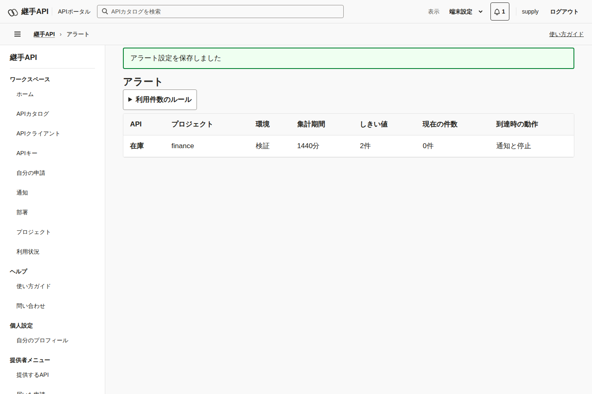

# 提供者は、利用上限に達したとき、通知または利用停止を適用できる

判定　合格

対象コミット　`3b3b95b91ac4a7521e19f5f4ca46ddef76f74135`

## 実行したテストと証跡

- 成功　3役で利用状況、ユーザー管理、名称で選んだ宛先への通知、ログ保存、掲載終了を確認する。（17.947 秒）　`tests/e2e/browser/test_portal.py::test_governance_console`
  - 
- 成功　同時実行の上限、通知のみ・停止・解除、次期間の回復、メトリクス集計とログの閲覧範囲を確認する（0.478 秒）　`packages/backend/tests/test_governance.py::test_alert_window_and_access_logs`

[テスト実行記録（JUnit XML）](%E6%8F%90%E4%BE%9B%E8%80%85%E3%81%AF%E3%80%81%E5%88%A9%E7%94%A8%E4%B8%8A%E9%99%90%E3%81%AB%E9%81%94%E3%81%97%E3%81%9F%E3%81%A8%E3%81%8D%E3%80%81%E9%80%9A%E7%9F%A5%E3%81%BE%E3%81%9F%E3%81%AF%E5%88%A9%E7%94%A8%E5%81%9C%E6%AD%A2%E3%82%92%E9%81%A9%E7%94%A8%E3%81%A7%E3%81%8D%E3%82%8B.xml)
