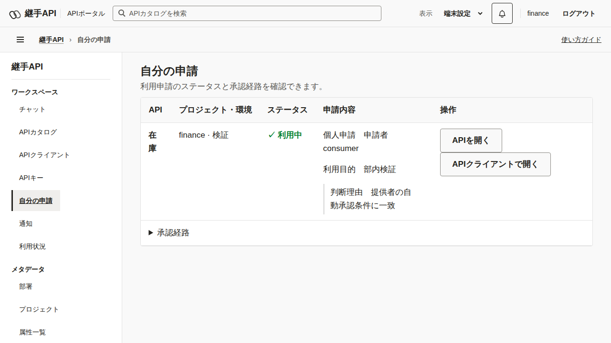

# 提供者は、利用条件で申請者の属性を指定したとき、利用申請を自動承認できる

判定　合格

対象コミット　`bd04303ea2ed84cc024bfad2a8ef6bb82c0cd224`

[検証した要件と変更履歴](https://github.com/tsuji-tomonori/tsugite-api/blob/bd04303ea2ed84cc024bfad2a8ef6bb82c0cd224/docs/requirements/items/%E6%8F%90%E4%BE%9B%E8%80%85%E3%81%AF%E3%80%81%E5%88%A9%E7%94%A8%E6%9D%A1%E4%BB%B6%E3%81%A7%E7%94%B3%E8%AB%8B%E8%80%85%E3%81%AE%E5%B1%9E%E6%80%A7%E3%82%92%E6%8C%87%E5%AE%9A%E3%81%97%E3%81%9F%E3%81%A8%E3%81%8D%E3%80%81%E5%88%A9%E7%94%A8%E7%94%B3%E8%AB%8B%E3%82%92%E8%87%AA%E5%8B%95%E6%89%BF%E8%AA%8D%E3%81%A7%E3%81%8D%E3%82%8B.md)

## 実行したテストと証跡

- 成功　提供者が公開・自動承認・委任の条件を保存し、部署リーダーが個人申請を画面から却下する（10.585 秒）　`tests/e2e/browser/test_delegation_console.py::test_provider_policy_console`
  - 
- 成功　公開範囲、委任判断、個人・プロジェクト別申請、部署・役職の自動承認を確認する（0.724 秒）　`packages/backend/tests/test_org_access.py::test_delegation_search_and_personal_isolation`
- 成功　所属属性が一致した場合の自動承認と、環境別の自動承認でも必要な規約同意を照合する。（形式仕様の操作と期待状態を照合する。）（0.729 秒）　`packages/backend/tests/test_quint_grants.py::test_automatic_decisions[automatic.autoTest]`

[テスト実行記録（JUnit XML）](%E6%8F%90%E4%BE%9B%E8%80%85%E3%81%AF%E3%80%81%E5%88%A9%E7%94%A8%E6%9D%A1%E4%BB%B6%E3%81%A7%E7%94%B3%E8%AB%8B%E8%80%85%E3%81%AE%E5%B1%9E%E6%80%A7%E3%82%92%E6%8C%87%E5%AE%9A%E3%81%97%E3%81%9F%E3%81%A8%E3%81%8D%E3%80%81%E5%88%A9%E7%94%A8%E7%94%B3%E8%AB%8B%E3%82%92%E8%87%AA%E5%8B%95%E6%89%BF%E8%AA%8D%E3%81%A7%E3%81%8D%E3%82%8B.xml)
