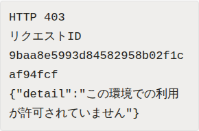

# 提供者は、利用権を終了するとき、利用権を取り消すことができる

判定　合格

対象コミット　`413280ee0b9fbeb2f02c47a6a1a2080583707787`

[検証した要件と変更履歴](https://github.com/tsuji-tomonori/tsugite-api/blob/413280ee0b9fbeb2f02c47a6a1a2080583707787/docs/requirements/items/%E6%8F%90%E4%BE%9B%E8%80%85%E3%81%AF%E3%80%81%E5%88%A9%E7%94%A8%E6%A8%A9%E3%82%92%E7%B5%82%E4%BA%86%E3%81%99%E3%82%8B%E3%81%A8%E3%81%8D%E3%80%81%E5%88%A9%E7%94%A8%E6%A8%A9%E3%82%92%E5%8F%96%E3%82%8A%E6%B6%88%E3%81%99%E3%81%93%E3%81%A8%E3%81%8C%E3%81%A7%E3%81%8D%E3%82%8B.md)

## 実行したテストと証跡

- 成功　デモの提供者と利用者が公開・申請・承認・実行・権限取消を画面で完了できる（9.139 秒）　`tests/e2e/browser/test_portal.py::test_user_flow`
  - 

[テスト実行記録（JUnit XML）](%E6%8F%90%E4%BE%9B%E8%80%85%E3%81%AF%E3%80%81%E5%88%A9%E7%94%A8%E6%A8%A9%E3%82%92%E7%B5%82%E4%BA%86%E3%81%99%E3%82%8B%E3%81%A8%E3%81%8D%E3%80%81%E5%88%A9%E7%94%A8%E6%A8%A9%E3%82%92%E5%8F%96%E3%82%8A%E6%B6%88%E3%81%99%E3%81%93%E3%81%A8%E3%81%8C%E3%81%A7%E3%81%8D%E3%82%8B.xml)
