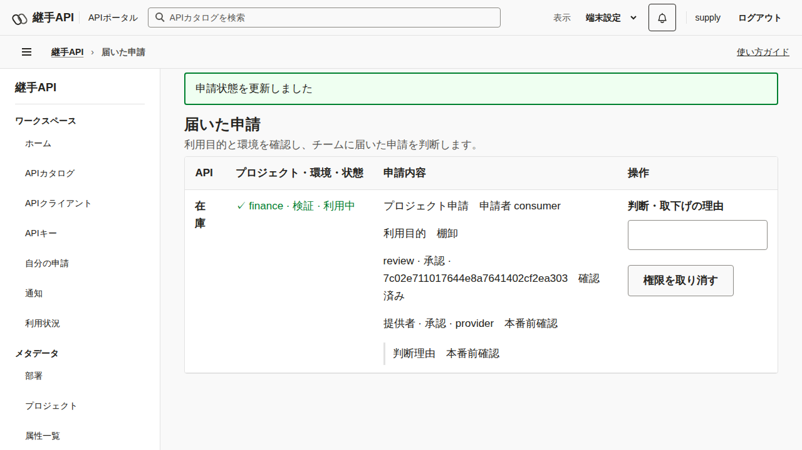

# 提供者は、利用申請に複数の判断が必要なとき、承認順を設定できる

判定　合格

対象コミット　`e77afc4a3eda88a0cba4fd2035ecaa9b1cd3bd8c`

[検証した要件と変更履歴](https://github.com/tsuji-tomonori/tsugite-api/blob/e77afc4a3eda88a0cba4fd2035ecaa9b1cd3bd8c/docs/requirements/items/%E6%8F%90%E4%BE%9B%E8%80%85%E3%81%AF%E3%80%81%E5%88%A9%E7%94%A8%E7%94%B3%E8%AB%8B%E3%81%AB%E8%A4%87%E6%95%B0%E3%81%AE%E5%88%A4%E6%96%AD%E3%81%8C%E5%BF%85%E8%A6%81%E3%81%AA%E3%81%A8%E3%81%8D%E3%80%81%E6%89%BF%E8%AA%8D%E9%A0%86%E3%82%92%E8%A8%AD%E5%AE%9A%E3%81%A7%E3%81%8D%E3%82%8B.md)

## 実行したテストと証跡

- 成功　部署リーダーの判断が済むまで提供者は承認できず、最終承認後に呼び出しが成功する。（4.884 秒）　`tests/e2e/browser/test_requirement_flows.py::test_ordered_review`
  - 
- 成功　環境別の承認条件を守り、複数の承認を指定の順序で行う（0.370 秒）　`packages/backend/tests/test_product_offers.py::test_three_environments_and_ordered_reviews`
- 成功　利用条件と部署・提供者の承認順を再生し、最終判断まで呼び出しを拒否する。（形式仕様の操作と期待状態を照合する。）（0.668 秒）　`packages/backend/tests/test_quint_grants.py::test_ordered_history[review.orderedTest]`
- 成功　利用条件と部署・提供者の承認順を再生し、最終判断まで呼び出しを拒否する。（形式仕様の操作と期待状態を照合する。）（0.292 秒）　`packages/backend/tests/test_quint_grants.py::test_ordered_history[review.termsTest]`

[テスト実行記録（JUnit XML）](%E6%8F%90%E4%BE%9B%E8%80%85%E3%81%AF%E3%80%81%E5%88%A9%E7%94%A8%E7%94%B3%E8%AB%8B%E3%81%AB%E8%A4%87%E6%95%B0%E3%81%AE%E5%88%A4%E6%96%AD%E3%81%8C%E5%BF%85%E8%A6%81%E3%81%AA%E3%81%A8%E3%81%8D%E3%80%81%E6%89%BF%E8%AA%8D%E9%A0%86%E3%82%92%E8%A8%AD%E5%AE%9A%E3%81%A7%E3%81%8D%E3%82%8B.xml)
