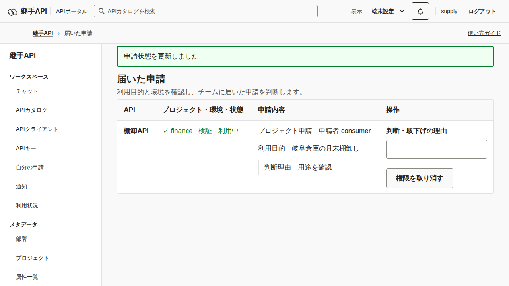

# 提供者は、利用申請を受けたとき、承認または却下を決定できる

判定　合格

対象コミット　`0d81e69c4ba4290f5d99ca15e8d1abe968d87a3b`

[検証した要件と変更履歴](https://github.com/tsuji-tomonori/tsugite-api/blob/0d81e69c4ba4290f5d99ca15e8d1abe968d87a3b/docs/requirements/items/%E6%8F%90%E4%BE%9B%E8%80%85%E3%81%AF%E3%80%81%E5%88%A9%E7%94%A8%E7%94%B3%E8%AB%8B%E3%82%92%E5%8F%97%E3%81%91%E3%81%9F%E3%81%A8%E3%81%8D%E3%80%81%E6%89%BF%E8%AA%8D%E3%81%BE%E3%81%9F%E3%81%AF%E5%8D%B4%E4%B8%8B%E3%82%92%E6%B1%BA%E5%AE%9A%E3%81%A7%E3%81%8D%E3%82%8B.md)

## 実行したテストと証跡

- 成功　デモの提供者と利用者が公開・申請・承認・実行・権限取消を画面で完了できる（8.834 秒）　`tests/e2e/browser/test_portal.py::test_user_flow`
  - 
- 成功　却下後に再申請でき、古い判断の再適用を拒否する（0.121 秒）　`packages/backend/tests/test_catalog.py::test_reapply`

[テスト実行記録（JUnit XML）](%E6%8F%90%E4%BE%9B%E8%80%85%E3%81%AF%E3%80%81%E5%88%A9%E7%94%A8%E7%94%B3%E8%AB%8B%E3%82%92%E5%8F%97%E3%81%91%E3%81%9F%E3%81%A8%E3%81%8D%E3%80%81%E6%89%BF%E8%AA%8D%E3%81%BE%E3%81%9F%E3%81%AF%E5%8D%B4%E4%B8%8B%E3%82%92%E6%B1%BA%E5%AE%9A%E3%81%A7%E3%81%8D%E3%82%8B.xml)
