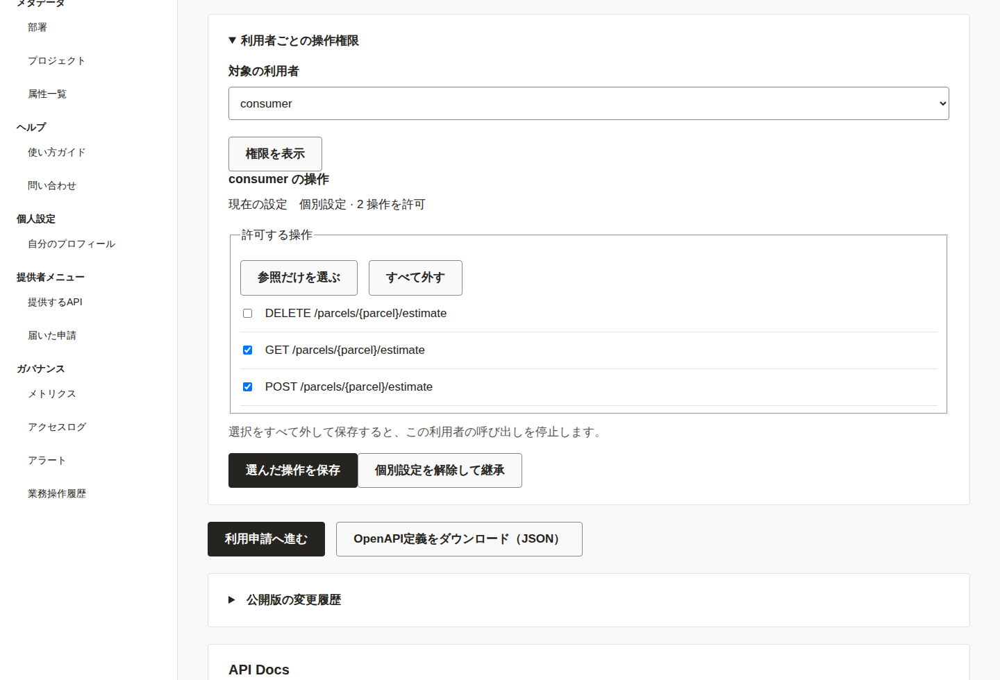

# 提供者は、利用者の実行範囲を制限するとき、API操作を指定できる

判定　合格

対象コミット　`eb58d72252bc5cbfdc0c62506b047798636d428f`

[検証した要件と変更履歴](https://github.com/tsuji-tomonori/tsugite-api/blob/eb58d72252bc5cbfdc0c62506b047798636d428f/docs/requirements/items/%E6%8F%90%E4%BE%9B%E8%80%85%E3%81%AF%E3%80%81%E5%88%A9%E7%94%A8%E8%80%85%E3%81%AE%E5%AE%9F%E8%A1%8C%E7%AF%84%E5%9B%B2%E3%82%92%E5%88%B6%E9%99%90%E3%81%99%E3%82%8B%E3%81%A8%E3%81%8D%E3%80%81API%E6%93%8D%E4%BD%9C%E3%82%92%E6%8C%87%E5%AE%9A%E3%81%A7%E3%81%8D%E3%82%8B.md)

## 実行したテストと証跡

- 成功　提供者が利用者の操作を選び、送料1,400円のHTTPS応答と権限変更直後の転送停止を照合する（10.686 秒）　`tests/e2e/browser/test_operation_console.py::test_person_operation_console`
  - 

[テスト実行記録（JUnit XML）](%E6%8F%90%E4%BE%9B%E8%80%85%E3%81%AF%E3%80%81%E5%88%A9%E7%94%A8%E8%80%85%E3%81%AE%E5%AE%9F%E8%A1%8C%E7%AF%84%E5%9B%B2%E3%82%92%E5%88%B6%E9%99%90%E3%81%99%E3%82%8B%E3%81%A8%E3%81%8D%E3%80%81API%E6%93%8D%E4%BD%9C%E3%82%92%E6%8C%87%E5%AE%9A%E3%81%A7%E3%81%8D%E3%82%8B.xml)
