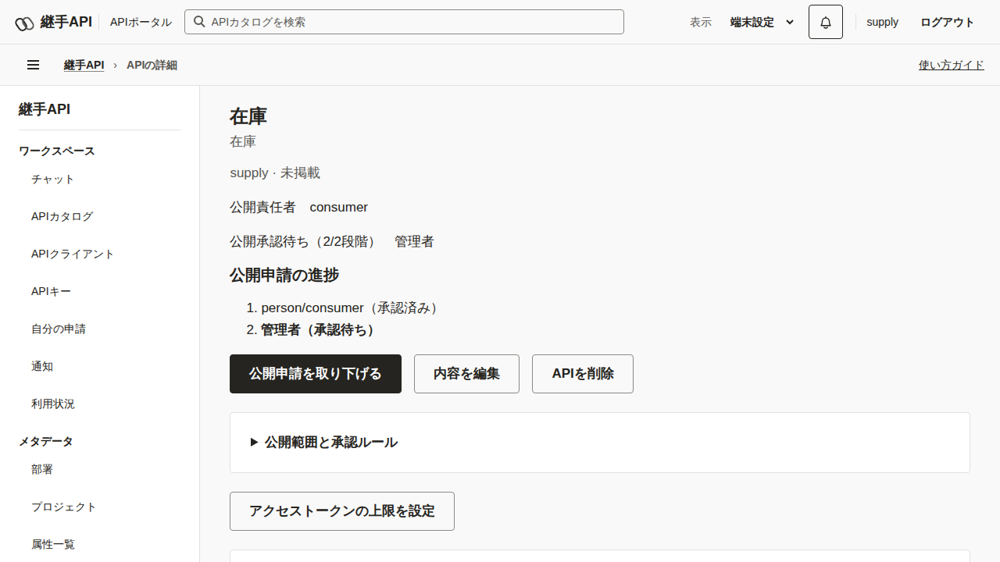

# 提供者は、商品の公開を申請したとき、承認の進捗を確認できる

判定　合格

対象コミット　`6ea13b6727fccc012bd33ea31a29b99858f4967b`

[検証した要件と変更履歴](https://github.com/tsuji-tomonori/tsugite-api/blob/6ea13b6727fccc012bd33ea31a29b99858f4967b/docs/requirements/items/%E6%8F%90%E4%BE%9B%E8%80%85%E3%81%AF%E3%80%81%E5%95%86%E5%93%81%E3%81%AE%E5%85%AC%E9%96%8B%E3%82%92%E7%94%B3%E8%AB%8B%E3%81%97%E3%81%9F%E3%81%A8%E3%81%8D%E3%80%81%E6%89%BF%E8%AA%8D%E3%81%AE%E9%80%B2%E6%8D%97%E3%82%92%E7%A2%BA%E8%AA%8D%E3%81%A7%E3%81%8D%E3%82%8B.md)

## 実行したテストと証跡

- 成功　同じ担当を含む三段階でも承認済み・承認待ち・未到達を申請順に表示する。（0.021 秒）　`packages/frontend/tests/test_required_product_views.py::test_owner_sees_publication_progress`
- 成功　提供一覧では公開済み商品と未掲載商品の状態を行ごとに区別できる。（0.005 秒）　`packages/frontend/tests/test_required_product_views.py::test_provider_inventory_distinguishes_listing_status`
- 成功　商品を公開し、利用者が商品詳細から利用申請できる（21.442 秒）　`tests/e2e/browser/test_product_publication.py::test_publish_and_apply_from_product_page`
  - 

[テスト実行記録（JUnit XML）](%E6%8F%90%E4%BE%9B%E8%80%85%E3%81%AF%E3%80%81%E5%95%86%E5%93%81%E3%81%AE%E5%85%AC%E9%96%8B%E3%82%92%E7%94%B3%E8%AB%8B%E3%81%97%E3%81%9F%E3%81%A8%E3%81%8D%E3%80%81%E6%89%BF%E8%AA%8D%E3%81%AE%E9%80%B2%E6%8D%97%E3%82%92%E7%A2%BA%E8%AA%8D%E3%81%A7%E3%81%8D%E3%82%8B.xml)
