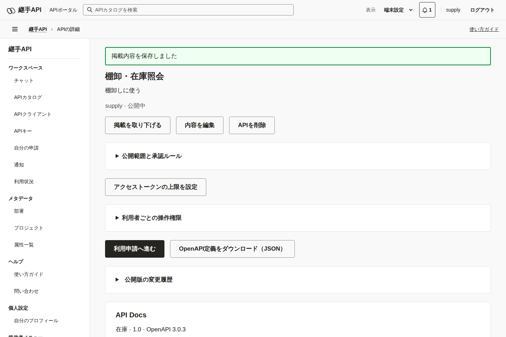

# 提供者は、商品の内容が変わったとき、掲載内容を変更できる

判定　合格

対象コミット　`ad3edd58d238011efbfa54ed486590536a4f2b83`

[検証した要件と変更履歴](https://github.com/tsuji-tomonori/tsugite-api/blob/ad3edd58d238011efbfa54ed486590536a4f2b83/docs/requirements/items/%E6%8F%90%E4%BE%9B%E8%80%85%E3%81%AF%E3%80%81%E5%95%86%E5%93%81%E3%81%AE%E5%86%85%E5%AE%B9%E3%81%8C%E5%A4%89%E3%82%8F%E3%81%A3%E3%81%9F%E3%81%A8%E3%81%8D%E3%80%81%E6%8E%B2%E8%BC%89%E5%86%85%E5%AE%B9%E3%82%92%E5%A4%89%E6%9B%B4%E3%81%A7%E3%81%8D%E3%82%8B.md)

## 実行したテストと証跡

- 成功　3役で利用状況、ユーザー管理、名称で選んだ宛先への通知、ログ保存、掲載終了を確認する。（12.830 秒）　`tests/e2e/browser/test_portal.py::test_governance_console`
  - 
- 成功　掲載内容の修正と仕様の変更を区別し、競合を検知し、削除後も監査を保持する（0.317 秒）　`packages/backend/tests/test_governance.py::test_listing_revisions`
- 成功　名称変更では利用権を保持し、構造変更・削除では公開と既存の権利を終了する。（形式仕様の操作と期待状態を照合する。）（0.246 秒）　`packages/backend/tests/test_quint_grants.py::test_product_history[products.deleteTest]`
- 成功　名称変更では利用権を保持し、構造変更・削除では公開と既存の権利を終了する。（形式仕様の操作と期待状態を照合する。）（0.259 秒）　`packages/backend/tests/test_quint_grants.py::test_product_history[products.editTest]`
- 成功　名称変更では利用権を保持し、構造変更・削除では公開と既存の権利を終了する。（形式仕様の操作と期待状態を照合する。）（0.497 秒）　`packages/backend/tests/test_quint_grants.py::test_product_history[products.pendingEditTest]`

[テスト実行記録（JUnit XML）](%E6%8F%90%E4%BE%9B%E8%80%85%E3%81%AF%E3%80%81%E5%95%86%E5%93%81%E3%81%AE%E5%86%85%E5%AE%B9%E3%81%8C%E5%A4%89%E3%82%8F%E3%81%A3%E3%81%9F%E3%81%A8%E3%81%8D%E3%80%81%E6%8E%B2%E8%BC%89%E5%86%85%E5%AE%B9%E3%82%92%E5%A4%89%E6%9B%B4%E3%81%A7%E3%81%8D%E3%82%8B.xml)
